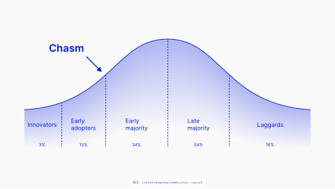

<!-- Generated by scripts/review.py sync. Edit template metadata or review.json. -->

# Adoption curve with stages

Explain values, metrics or relationships using the adoption curve with stages layout.

Model: `adoption-curve` · Family: Data · Status: **in review**.

[Getting started](../../USING-STUDIO.md) · [All slide guides](../GUIDES.md) · [Current LaTeX source](../../../templates/studio/adoption-curve.tex)

[Open this slide individually](../index.html?template=adoption-curve)



The preview shows the shipped defaults. The thin bottom label belongs to the review catalogue.

## Insert this slide

Place this command outside another `frame`:

```latex
\studiotemplate{adoption-curve}
```

## Change the content

This example uses supported fields. Omitted fields keep their shipped defaults.

```latex
\studiotemplate[
  title={Chasm},
  text-1={Innovators}
]{adoption-curve}
```

## Complete one-slide example

Create `my-slide.tex` in the project root and paste:

```latex
\documentclass[aspectratio=169]{beamer}
\usetheme{bitpolito-studio}
\usepackage{bitpolitostudiotemplates}
\usepackage[backend=biber]{biblatex}
\addbibresource{bibliography.bib}
\begin{document}
\studiotemplate[
  title={Chasm},
  text-1={Innovators}
]{adoption-curve}
\end{document}
```

```sh
python3 scripts/build.py my-slide.tex
# Installed TeX alternative:
python3 scripts/build.py my-slide.tex --backend native
```

Output: `build/my-slide.pdf`. On Windows use `py -3` instead of `python3`.

## Editable fields

Positions and available space refer to the original, fixed composition.
In the individual web view, select a field or enable **Show editable areas** to locate it.

| Field | What it changes | Position | Available space | Shipped value |
| --- | --- | --- | --- | --- |
| <code>graphic-1</code> | Replaceable graphic or decoration (graphic) | middle centre | 86.8% wide × 61.1% high | <code>\includegraphics[width=3087\studiounit]{images/studio/collection/figma-0051-part-01.pdf}</code> |
| <code>text-1</code> | Editable text (text) | lower left | 9.9% wide × 4.3% high | <code>Innovators</code> |
| <code>text-2</code> | Editable text (text) | lower right | 9.0% wide × 4.9% high | <code>Laggards</code> |
| <code>text-3</code> | Editable text (text) | lower left | 8.7% wide × 9.1% high | <code>Early\\adopters</code> |
| <code>text-4</code> | Editable text (text) | lower centre | 7.9% wide × 9.1% high | <code>Early\\majority</code> |
| <code>text-5</code> | Editable text (text) | lower centre | 7.9% wide × 9.1% high | <code>Late\\majority</code> |
| <code>title</code> | Main text (text) | upper left | 12.4% wide × 7.6% high | <code>Chasm</code> |
| <code>text-7</code> | Editable text (text) | lower left | 2.8% wide × 3.2% high | <code>3\%</code> |
| <code>text-8</code> | Editable text (text) | lower left | 3.5% wide × 3.2% high | <code>13\%</code> |
| <code>text-9</code> | Editable text (text) | lower centre | 3.7% wide × 3.2% high | <code>34\%</code> |
| <code>text-10</code> | Editable text (text) | lower centre | 3.7% wide × 3.2% high | <code>34\%</code> |
| <code>text-11</code> | Editable text (text) | lower right | 3.5% wide × 3.2% high | <code>16\%</code> |

Truncated values are shown in full at the start of the current source file.
A text field accepts LaTeX; a graphic field accepts an icon, `\includegraphics`, TikZ or math.

## Replace a graphic

This example fits an icon inside the first graphic slot, preserving its proportions:

```latex
\studiotemplate[
  graphic-1={\asset[width=0.78130\paperwidth,height=0.54945\paperheight,keepaspectratio]{alice}}
]{adoption-curve}
```

Use any graphic field listed above to target another slot. Some slots contain a complete
panel, background, screenshot or decoration. Inspect the preview before replacing them.

## Keep the composition

- Keep replacements within their allocated boxes. Shorten text or use explicit `\\` line breaks.
- Use `field={}` to hide content while retaining its space.
- Fonts, anchors and geometry remain fixed; unknown fields and overflowing content produce diagnostics.
- Text colour does not recolour supplied graphics; prepare another asset when its fixed colours must change.
- Some diagrams, QR codes and decorations are native source elements rather than configurable fields.
- For structural changes, edit [the current source](../../../templates/studio/adoption-curve.tex). Catalogues and the showcase reuse it.

## Review

Reference: figma-0051.

Review margins, text, crops, shadows and optical balance using this stable model ID.
Record feedback in [the review ledger](../../../templates/review.json). Compilation is not graphical approval.
