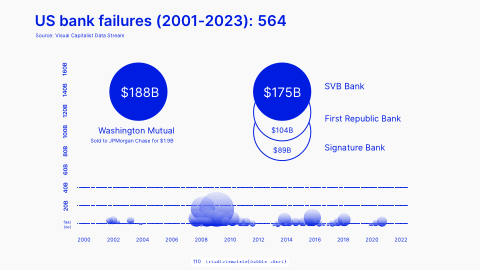

<!-- Generated by scripts/review.py sync. Edit template metadata or review.json. -->

# Bubble Chart

Explain values, metrics or relationships using the bubble chart layout.

Model: `bubble-chart` · Family: Data · Status: **in review**.

[Getting started](../../USING-STUDIO.md) · [All slide guides](../GUIDES.md) · [Current LaTeX source](../../../templates/studio/bubble-chart.tex)

[Open this slide individually](../index.html?template=bubble-chart)



The preview shows the shipped defaults. The thin bottom label belongs to the review catalogue.

## Insert this slide

Place this command outside another `frame`:

```latex
\studiotemplate{bubble-chart}
```

## Change the content

This example uses supported fields. Omitted fields keep their shipped defaults.

```latex
\studiotemplate[
  title={US bank failures (2001-2023): 564},
  text-2={Source: Visual Capitalist Data Stream}
]{bubble-chart}
```

## Complete one-slide example

Create `my-slide.tex` in the project root and paste:

```latex
\documentclass[aspectratio=169]{beamer}
\usetheme{bitpolito-studio}
\usepackage{bitpolitostudiotemplates}
\usepackage[backend=biber]{biblatex}
\addbibresource{bibliography.bib}
\begin{document}
\studiotemplate[
  title={US bank failures (2001-2023): 564},
  text-2={Source: Visual Capitalist Data Stream}
]{bubble-chart}
\end{document}
```

```sh
python3 scripts/build.py my-slide.tex
# Installed TeX alternative:
python3 scripts/build.py my-slide.tex --backend native
```

Output: `build/my-slide.pdf`. On Windows use `py -3` instead of `python3`.

## Editable fields

Positions and available space refer to the original, fixed composition.
In the individual web view, select a field or enable **Show editable areas** to locate it.

| Field | What it changes | Position | Available space | Shipped value |
| --- | --- | --- | --- | --- |
| <code>graphic-1</code> | Replaceable graphic or decoration (graphic) | lower left | 2.2% wide × 6.2% high | <code>\includegraphics[width=80\studiounit]{images/studio/collection/figma-0006-part-01.pdf}</code> |
| <code>graphic-2</code> | Replaceable graphic or decoration (graphic) | lower left | 2.2% wide × 6.3% high | <code>\includegraphics[width=80\studiounit]{images/studio/collection/figma-0006-part-02.pdf}</code> |
| <code>graphic-3</code> | Replaceable graphic or decoration (graphic) | middle left | 2.2% wide × 6.3% high | <code>\includegraphics[width=80\studiounit]{images/studio/collection/figma-0006-part-03.pdf}</code> |
| <code>graphic-4</code> | Replaceable graphic or decoration (graphic) | middle left | 2.2% wide × 6.2% high | <code>\includegraphics[width=80\studiounit]{images/studio/collection/figma-0006-part-04.pdf}</code> |
| <code>graphic-5</code> | Replaceable graphic or decoration (graphic) | middle left | 2.2% wide × 7.2% high | <code>\includegraphics[width=80\studiounit]{images/studio/collection/figma-0006-part-05.pdf}</code> |
| <code>graphic-6</code> | Replaceable graphic or decoration (graphic) | middle left | 2.2% wide × 7.1% high | <code>\includegraphics[width=80\studiounit]{images/studio/collection/figma-0006-part-06.pdf}</code> |
| <code>graphic-7</code> | Replaceable graphic or decoration (graphic) | middle left | 2.2% wide × 7.2% high | <code>\includegraphics[width=80\studiounit]{images/studio/collection/figma-0006-part-07.pdf}</code> |
| <code>graphic-8</code> | Replaceable graphic or decoration (graphic) | upper left | 2.2% wide × 7.2% high | <code>\includegraphics[width=80\studiounit]{images/studio/collection/figma-0006-part-08.pdf}</code> |
| <code>graphic-9</code> | Replaceable graphic or decoration (graphic) | lower centre | 70.4% wide × 15.5% high | <code>\includegraphics[width=2502\studiounit]{images/studio/collection/figma-0006-part-09.pdf}</code> |
| <code>graphic-10</code> | Replaceable graphic or decoration (graphic) | lower centre | 70.4% wide × 2.6% high | <code>\includegraphics[width=2502\studiounit]{images/studio/collection/figma-0006-part-10.pdf}</code> |
| <code>graphic-11</code> | Replaceable graphic or decoration (graphic) | middle centre | 13.9% wide × 39.2% high | <code>\includegraphics[width=493\studiounit]{images/studio/collection/figma-0006-part-11.pdf}</code> |
| <code>graphic-12</code> | Replaceable graphic or decoration (graphic) | middle left | 13.5% wide × 24.1% high | <code>\includegraphics[width=480\studiounit]{images/studio/collection/figma-0006-part-12.pdf}</code> |
| <code>title</code> | Main text (text) | upper centre | 61.4% wide × 8.6% high | <code>US bank failures (2001-2023): 564</code> |
| <code>text-2</code> | Editable text (text) | upper left | 19.1% wide × 3.0% high | <code>Source: Visual Capitalist Data Stream</code> |
| <code>text-3</code> | Editable text (text) | lower left | 1.4% wide × 3.4% high | <code>faa)\\(oe)</code> |
| <code>text-4</code> | Editable text (text) | lower left | 3.6% wide × 2.7% high | <code>2000</code> |
| <code>text-5</code> | Editable text (text) | lower left | 3.5% wide × 2.7% high | <code>2002</code> |
| <code>text-6</code> | Editable text (text) | lower left | 3.6% wide × 2.7% high | <code>2004</code> |
| <code>text-7</code> | Editable text (text) | lower centre | 3.6% wide × 2.7% high | <code>2006</code> |
| <code>text-8</code> | Editable text (text) | lower centre | 3.6% wide × 2.7% high | <code>2008</code> |
| <code>text-9</code> | Editable text (text) | lower centre | 3.4% wide × 2.7% high | <code>2010</code> |
| <code>text-10</code> | Editable text (text) | lower centre | 3.3% wide × 2.7% high | <code>2012</code> |
| <code>text-11</code> | Editable text (text) | lower centre | 3.4% wide × 2.7% high | <code>2014</code> |
| <code>text-12</code> | Editable text (text) | lower centre | 3.4% wide × 2.7% high | <code>2016</code> |
| <code>text-13</code> | Editable text (text) | lower right | 3.4% wide × 2.7% high | <code>2018</code> |
| <code>text-14</code> | Editable text (text) | lower right | 3.5% wide × 2.7% high | <code>2020</code> |
| <code>text-15</code> | Editable text (text) | lower right | 3.5% wide × 2.7% high | <code>2022</code> |
| <code>text-16</code> | Editable text (text) | middle left | 20.4% wide × 3.1% high | <code>Sold to JPMorgan Chase for \$1.9B</code> |
| <code>text-17</code> | Editable text (text) | middle left | 9.4% wide × 6.6% high | <code>\$188B</code> |
| <code>text-18</code> | Editable text (text) | middle centre | 9.7% wide × 6.6% high | <code>\$175B</code> |
| <code>text-19</code> | Editable text (text) | upper right | 9.7% wide × 4.4% high | <code>SVB Bank</code> |
| <code>text-20</code> | Editable text (text) | middle left | 17.9% wide × 5.0% high | <code>Washington Mutual</code> |
| <code>text-21</code> | Editable text (text) | middle right | 17.7% wide × 4.9% high | <code>First Republic Bank</code> |
| <code>text-22</code> | Editable text (text) | middle right | 14.4% wide × 5.0% high | <code>Signature Bank</code> |
| <code>text-23</code> | Editable text (text) | middle centre | 10.9% wide × 3.7% high | <code>\$104B</code> |
| <code>text-24</code> | Editable text (text) | middle centre | 10.9% wide × 3.7% high | <code>\$89B</code> |

Truncated values are shown in full at the start of the current source file.
A text field accepts LaTeX; a graphic field accepts an icon, `\includegraphics`, TikZ or math.

## Replace a graphic

This example fits an icon inside the first graphic slot, preserving its proportions:

```latex
\studiotemplate[
  graphic-1={\asset[width=0.02025\paperwidth,height=0.05535\paperheight,keepaspectratio]{alice}}
]{bubble-chart}
```

Use any graphic field listed above to target another slot. Some slots contain a complete
panel, background, screenshot or decoration. Inspect the preview before replacing them.

## Keep the composition

- Keep replacements within their allocated boxes. Shorten text or use explicit `\\` line breaks.
- Use `field={}` to hide content while retaining its space.
- Fonts, anchors and geometry remain fixed; unknown fields and overflowing content produce diagnostics.
- Text colour does not recolour supplied graphics; prepare another asset when its fixed colours must change.
- Some diagrams, QR codes and decorations are native source elements rather than configurable fields.
- For structural changes, edit [the current source](../../../templates/studio/bubble-chart.tex). Catalogues and the showcase reuse it.

## Review

Reference: figma-0006.

Review margins, text, crops, shadows and optical balance using this stable model ID.
Record feedback in [the review ledger](../../../templates/review.json). Compilation is not graphical approval.
