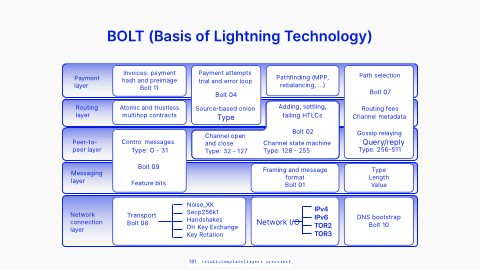

<!-- Generated by scripts/review.py sync. Edit template metadata or review.json. -->

# Layers Overview

Present technical content in a measured composition using the layers overview layout.

Model: `layers-overview` · Family: Technical · Status: **in review**.

[Getting started](../../USING-STUDIO.md) · [All slide guides](../GUIDES.md) · [Current LaTeX source](../../../templates/studio/layers-overview.tex)

[Open this slide individually](../index.html?template=layers-overview)



The preview shows the shipped defaults. The thin bottom label belongs to the review catalogue.

## Insert this slide

Place this command outside another `frame`:

```latex
\studiotemplate{layers-overview}
```

## Change the content

This example uses supported fields. Omitted fields keep their shipped defaults.

```latex
\studiotemplate[
  title={BOLT (Basis of Lightning Technology)},
  text-2={DNS bootstrap\\Bolt 10}
]{layers-overview}
```

## Complete one-slide example

Create `my-slide.tex` in the project root and paste:

```latex
\documentclass[aspectratio=169]{beamer}
\usetheme{bitpolito-studio}
\usepackage{bitpolitostudiotemplates}
\usepackage[backend=biber]{biblatex}
\addbibresource{bibliography.bib}
\begin{document}
\studiotemplate[
  title={BOLT (Basis of Lightning Technology)},
  text-2={DNS bootstrap\\Bolt 10}
]{layers-overview}
\end{document}
```

```sh
python3 scripts/build.py my-slide.tex
# Installed TeX alternative:
python3 scripts/build.py my-slide.tex --backend native
```

Output: `build/my-slide.pdf`. On Windows use `py -3` instead of `python3`.

## Editable fields

Positions and available space refer to the original, fixed composition.
In the individual web view, select a field or enable **Show editable areas** to locate it.

| Field | What it changes | Position | Available space | Shipped value |
| --- | --- | --- | --- | --- |
| <code>graphic-1</code> | Replaceable graphic or decoration (graphic) | middle centre | 75.5% wide × 70.5% high | <code>\includegraphics[width=2685\studiounit]{images/studio/collection/figma-0642-part-01.pdf}</code> |
| <code>title</code> | Main text (text) | upper centre | 57.2% wide × 8.6% high | <code>BOLT (Basis of Lightning Technology)</code> |
| <code>text-2</code> | Editable text (text) | lower right | 13.5% wide × 6.2% high | <code>DNS bootstrap\\Bolt 10</code> |
| <code>text-3</code> | Editable text (text) | lower centre | 16.8% wide × 3.9% high | <code>Network I/O</code> |
| <code>text-4</code> | Editable text (text) | lower centre | 12.1% wide × 15.8% high | <code>Noise\_XK\\Secp256k1\\Handshakes\par DH Key Exchange\\Key Rotation</code> |
| <code>text-5</code> | Editable text (text) | lower centre | 24.5% wide × 6.2% high | <code>Transport\\Bolt 08</code> |
| <code>text-6</code> | Editable text (text) | lower centre | 72.0% wide × 9.7% high | <code>Network\\connection\\layer</code> |
| <code>text-7</code> | Editable text (text) | middle centre | 17.4% wide × 9.3% high | <code>Framing and message\\format\\Bolt 01</code> |
| <code>text-8</code> | Editable text (text) | middle centre | 71.8% wide × 6.7% high | <code>Messaging\\layer</code> |
| <code>item-9-1</code> | List or contents entry (text) | middle left | 13.2% wide × 3.6% high | <code>Control messages</code> |
| <code>item-9-2</code> | List or contents entry (text) | middle left | 11.2% wide × 3.6% high | <code>Type: O - 31</code> |
| <code>item-9-3</code> | List or contents entry (text) | middle centre | 9.8% wide × 3.2% high | <code>Bolt 09</code> |
| <code>item-9-4</code> | List or contents entry (text) | lower left | 11.2% wide × 3.2% high | <code>Feature bits</code> |
| <code>text-10</code> | Editable text (text) | middle centre | 15.4% wide × 6.7% high | <code>Channel state machine\\Type: 128 - 255</code> |
| <code>text-11</code> | Editable text (text) | middle centre | 27.6% wide × 9.7% high | <code>Channel open\\and close\\Type: 32 - 127</code> |
| <code>text-12</code> | Editable text (text) | middle centre | 71.5% wide × 6.6% high | <code>Peer-to-\\peer layer</code> |
| <code>text-13</code> | Editable text (text) | upper centre | 71.2% wide × 6.6% high | <code>Payment\\layer</code> |
| <code>text-14</code> | Editable text (text) | middle centre | 70.8% wide × 6.7% high | <code>Routing\\layer</code> |
| <code>text-15</code> | Editable text (text) | upper left | 14.4% wide × 9.3% high | <code>Invoices: payment\\hash and preimage\\Bolt 11</code> |
| <code>text-16</code> | Editable text (text) | middle left | 14.4% wide × 6.7% high | <code>Atomic and trustless\\multihop contracts</code> |
| <code>item-17-1</code> | List or contents entry (text) | middle centre | 12.2% wide × 3.6% high | <code>Adding, settling,</code> |
| <code>item-17-2</code> | List or contents entry (text) | middle centre | 11.4% wide × 3.7% high | <code>failing HTLCs</code> |
| <code>item-17-3</code> | List or contents entry (text) | middle centre | 9.4% wide × 3.2% high | <code>Bolt 02</code> |
| <code>item-18-1</code> | List or contents entry (text) | upper centre | 12.7% wide × 3.5% high | <code>Payment attempts</code> |
| <code>item-18-2</code> | List or contents entry (text) | upper centre | 12.7% wide × 3.6% high | <code>trial and error loop</code> |
| <code>item-18-3</code> | List or contents entry (text) | middle centre | 9.2% wide × 3.2% high | <code>Bolt 04</code> |
| <code>item-18-4</code> | List or contents entry (text) | middle centre | 13.4% wide × 3.2% high | <code>Source-based onion</code> |
| <code>item-18-5</code> | List or contents entry (text) | middle centre | 21.4% wide × 3.9% high | <code>Type</code> |
| <code>item-19-1</code> | List or contents entry (text) | upper right | 11.1% wide × 3.2% high | <code>Path selection</code> |
| <code>item-19-2</code> | List or contents entry (text) | middle right | 8.8% wide × 3.2% high | <code>Bolt 07</code> |
| <code>item-19-3</code> | List or contents entry (text) | middle right | 10.6% wide × 3.6% high | <code>Routing fees</code> |
| <code>item-19-4</code> | List or contents entry (text) | middle right | 12.4% wide × 3.2% high | <code>Channel metadata</code> |
| <code>item-19-5</code> | List or contents entry (text) | middle right | 11.5% wide × 3.6% high | <code>Gossip relaying</code> |
| <code>item-19-6</code> | List or contents entry (text) | middle right | 10.2% wide × 3.9% high | <code>Query/reply</code> |
| <code>item-19-7</code> | List or contents entry (text) | middle right | 11.2% wide × 3.6% high | <code>Type: 256-511</code> |
| <code>text-20</code> | Editable text (text) | upper centre | 14.2% wide × 6.7% high | <code>Pathfinding (MPP,\\rebalancing, ...)</code> |
| <code>text-21</code> | Editable text (text) | lower right | 13.5% wide × 9.2% high | <code>Type\\Length\\Value</code> |

Truncated values are shown in full at the start of the current source file.
A text field accepts LaTeX; a graphic field accepts an icon, `\includegraphics`, TikZ or math.

## Replace a graphic

This example fits an icon inside the first graphic slot, preserving its proportions:

```latex
\studiotemplate[
  graphic-1={\asset[width=0.67956\paperwidth,height=0.63405\paperheight,keepaspectratio]{alice}}
]{layers-overview}
```

Use any graphic field listed above to target another slot. Some slots contain a complete
panel, background, screenshot or decoration. Inspect the preview before replacing them.

## Keep the composition

- Keep replacements within their allocated boxes. Shorten text or use explicit `\\` line breaks.
- Use `field={}` to hide content while retaining its space.
- Fonts, anchors and geometry remain fixed; unknown fields and overflowing content produce diagnostics.
- Text colour does not recolour supplied graphics; prepare another asset when its fixed colours must change.
- Some diagrams, QR codes and decorations are native source elements rather than configurable fields.
- For structural changes, edit [the current source](../../../templates/studio/layers-overview.tex). Catalogues and the showcase reuse it.

## Review

Reference: figma-0642.

Review margins, text, crops, shadows and optical balance using this stable model ID.
Record feedback in [the review ledger](../../../templates/review.json). Compilation is not graphical approval.
