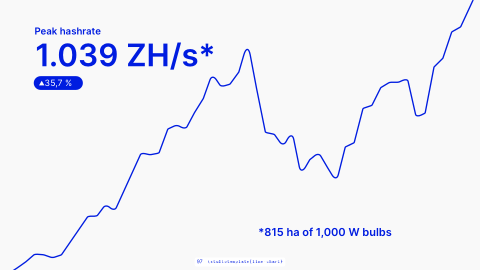

<!-- Generated by scripts/review.py sync. Edit template metadata or review.json. -->

# Illustrative line chart

Present a chart; data can come from CSV.

Model: `line-chart` · Family: Data · Status: **in review**.

[Getting started](../../USING-STUDIO.md) · [All slide guides](../GUIDES.md) · [Content API](../../STUDIO-CONTENT.md) · [Current LaTeX source](../../../templates/studio/line-chart.tex)

[Open this slide individually](../index.html?template=line-chart)



The preview shows the shipped defaults. The thin bottom label belongs to the review catalogue.

## Typed content slots

Use `text/N` for text, `icon/N` for an icon name, `image/N` for an image path,
and `graphic/N` for LaTeX graphics. Numbers are local to this model and stored
in its metadata; the map below shows their positions. Supplied graphics are fitted
proportionally. Text fonts and alignment remain fixed.

Use `clear=text` to remove shipped copy before adding your own; option order does not matter.
Omitted fields keep their defaults. Named aliases such as `text/title` also work.

| Public slot | Existing field | Content and appearance |
| --- | --- | --- |
| `icon/1`, `image/1`, `graphic/1` | `graphic-1` | Replaces this complete graphic; other elements stay fixed. |
| `text/1` | `text-1` | Editable text |
| `text/2` | `title` | Headline value |
| `text/3` | `text-3` | Editable text |
| `text/4` | `text-4` | Editable text |
| `file/1` | `data-file` | Path to an x,y CSV file |

Original unscoped field names remain compatible. For a labelled block, changing
`text/N` replaces the complete box; use `heading/N` and `body/N` for structured edits.

## Insert this slide

Place this command outside another `frame`:

```latex
\studiotemplate{line-chart}
```

## Change the content

This example uses supported fields. Omitted fields keep their shipped defaults.

```latex
\studiotemplate[
  text/2={Demo},
  text/1={Example curve},
  text/3={},
  text/4={Illustrative data},
  file/1={examples/data/studio-line.csv}
]{line-chart}
```

## Complete one-slide example

Create `my-slide.tex` in the project root and paste:

```latex
\documentclass[aspectratio=169]{beamer}
\usetheme{bitpolito-studio}
\usepackage{bitpolitostudiotemplates}
\usepackage[backend=biber]{biblatex}
\addbibresource{bibliography.bib}
\begin{document}
\studiotemplate[
  text/2={Demo},
  text/1={Example curve},
  text/3={},
  text/4={Illustrative data},
  file/1={examples/data/studio-line.csv}
]{line-chart}
\end{document}
```

```sh
python3 scripts/build.py my-slide.tex
# Installed TeX alternative:
python3 scripts/build.py my-slide.tex --backend native
```

Output: `build/my-slide.pdf`. On Windows use `py -3` instead of `python3`.

## Editable fields

Positions and available space refer to the original, fixed composition.
In the individual web view, select a field or enable **Show editable areas** to locate it.

| Field | What it changes | Position | Available space | Shipped value |
| --- | --- | --- | --- | --- |
| <code>graphic-1</code> | Complete graphic, image or decoration (graphic) | middle centre | 100.0% wide × 100.0% high | <code>\includegraphics[width=3556\studiounit]{images/studio/collection/figma-0818-part-01.pdf}</code> |
| <code>text-1</code> | Editable text (text) | upper left | 18.1% wide × 5.0% high | <code>Peak hashrate</code> |
| <code>title</code> | Headline value (text) | upper left | 41.3% wide × 17.8% high | <code>1.039 ZH/s*</code> |
| <code>text-3</code> | Editable text (text) | upper left | 8.3% wide × 4.9% high | <code>35,7 \%</code> |
| <code>text-4</code> | Editable text (text) | lower right | 39.8% wide × 6.4% high | <code>*815 ha of 1,000 W bulbs</code> |
| <code>data-file</code> | Path to an x,y CSV file (file) | See source | Source-defined | <code>(empty)</code> |

Truncated values are shown in full at the start of the current source file.
A text field accepts LaTeX; a graphic field accepts an icon, `\includegraphics`, TikZ or math.

## Replace a graphic

This example selects an icon by catalogue name; its size and position come from the slot:

```latex
\studiotemplate[
  icon/1={alice}
]{line-chart}
```

Use a numbered slot listed above to target another graphic. Some slots contain a complete
panel, background, screenshot or decoration. Inspect the preview before replacing them.

## Chart data

Set `data-file` to a CSV with header `x,y`. An empty value keeps the shipped graphic.
Update the labels as well as the curve; example CSV values are illustrative.

```csv
x,y
1,2
2,3
3,5
```

## Keep the composition

- Keep replacements within their allocated boxes. Shorten text or use explicit `\\` line breaks.
- Use `text/N={}` or `icon/N={}` to hide content while retaining its space; separated card panels stay visible.
- Fonts, anchors and geometry remain fixed; unknown fields and overflowing content produce diagnostics.
- Text colour does not recolour supplied graphics; prepare another asset when its fixed colours must change.
- Some diagrams, QR codes and decorations are native source elements rather than configurable fields.
- For structural changes, edit [the current source](../../../templates/studio/line-chart.tex). Catalogues and the showcase reuse it.

## Compatibility names

These names share this source and may apply different shipped field defaults:

- `\studiotemplate{annotated-area}`

## Review

Reference: figma-0818.

Review margins, text, crops, shadows and optical balance using this stable model ID.
Record feedback in [the review ledger](../../../templates/review.json). Compilation is not graphical approval.
