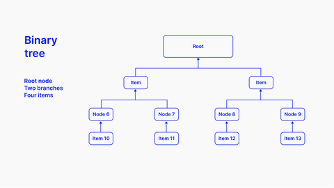

<!-- Generated by scripts/review.py sync. Edit template metadata or review.json. -->

# Merkle hash tree

Demonstrate this reusable composition.

Model: `merkle-tree` · Family: Technical · Status: **in review**.

[Getting started](../../USING-STUDIO.md) · [All slide guides](../GUIDES.md) · [Content API](../../STUDIO-CONTENT.md) · [Current LaTeX source](../../../templates/studio/merkle-tree.tex)

[Open this slide individually](../../slides/index.html?template=merkle-tree)



The preview shows the shipped defaults. The thin bottom label belongs to the review catalogue.

## Grouped model

[Model variants and named fields](../models/binary-tree.md)

```latex
\studiotemplate[variant=compact,palette=light]{binary-tree}
```

Named fields are coherent across related variants. All old fields and numbered slots remain available.

Numeric defaults and charts are illustrative.

## Typed content slots

Use `text/N` for text, `icon/N` for an icon name, `image/N` for an image path,
and `graphic/N` for LaTeX graphics. Numbers are local to this model and stored
in its metadata; the map below shows their positions. Supplied graphics are fitted
proportionally. Text fonts and alignment remain fixed.

Use `clear=text` to remove shipped copy before adding your own; option order does not matter.
Omitted fields keep their defaults. Named aliases such as `text/title` also work.

| Public slot | Existing field | Content and appearance |
| --- | --- | --- |
| `text/1` | `title` | Main text |
| `text/3` | `explanation` | Supporting explanation |
| `text/2` | `root` | Root label |
| `text/4` | `ab` | Left intermediate hash label |
| `text/5` | `cd` | Right intermediate hash label |
| `text/6` | `hash-0` | Leaf hash label |
| `text/10` | `tx-0` | Transaction label |
| `text/7` | `hash-1` | Leaf hash label |
| `text/11` | `tx-1` | Transaction label |
| `text/8` | `hash-2` | Leaf hash label |
| `text/12` | `tx-2` | Transaction label |
| `text/9` | `hash-3` | Leaf hash label |
| `text/13` | `tx-3` | Transaction label |

Original unscoped field names remain compatible. For a labelled block, changing
`text/N` replaces the complete box; use `heading/N` and `body/N` for structured edits.

## Insert this slide

Place this command outside another `frame`:

```latex
\studiotemplate{merkle-tree}
```

## Change the content

This example uses supported fields. Omitted fields keep their shipped defaults.

```latex
\studiotemplate[
  text/1={Binary\\tree}
]{merkle-tree}
```

## Complete one-slide example

Create `my-slide.tex` in the project root and paste:

```latex
\documentclass[aspectratio=169]{beamer}
\usetheme{bitpolito-studio}
\usepackage{bitpolitostudiotemplates}
\usepackage[backend=biber]{biblatex}
\addbibresource{bibliography.bib}
\begin{document}
\studiotemplate[
  text/1={Binary\\tree}
]{merkle-tree}
\end{document}
```

```sh
python3 scripts/build.py my-slide.tex
# Installed TeX alternative:
python3 scripts/build.py my-slide.tex --backend native
```

Output: `build/my-slide.pdf`. On Windows use `py -3` instead of `python3`.

## Editable fields

Positions and available space refer to the original, fixed composition.
In the individual web view, select a field or enable **Show editable areas** to locate it.

| Field | What it changes | Position | Available space | Shipped value |
| --- | --- | --- | --- | --- |
| <code>title</code> | Main text (text) | upper left | 16.9% wide × 14.0% high | <code>Binary\\tree</code> |
| <code>explanation</code> | Supporting explanation (text) | middle left | 15.5% wide × 27.5% high | <code>Root node\\Two branches\\Four items</code> |
| <code>root</code> | Root label (text) | upper centre | 20.8% wide × 3.5% high | <code>Root</code> |
| <code>ab</code> | Left intermediate hash label (text) | middle centre | 7.2% wide × 3.5% high | <code>Item</code> |
| <code>cd</code> | Right intermediate hash label (text) | middle right | 7.2% wide × 3.5% high | <code>Item</code> |
| <code>hash-0</code> | Leaf hash label (text) | middle left | 7.2% wide × 3.5% high | <code>Node 6</code> |
| <code>tx-0</code> | Transaction label (text) | lower left | 7.2% wide × 3.5% high | <code>Item 10</code> |
| <code>hash-1</code> | Leaf hash label (text) | middle centre | 7.2% wide × 3.5% high | <code>Node 7</code> |
| <code>tx-1</code> | Transaction label (text) | lower centre | 7.2% wide × 3.5% high | <code>Item 11</code> |
| <code>hash-2</code> | Leaf hash label (text) | middle right | 7.2% wide × 3.5% high | <code>Node 8</code> |
| <code>tx-2</code> | Transaction label (text) | lower right | 7.2% wide × 3.5% high | <code>Item 12</code> |
| <code>hash-3</code> | Leaf hash label (text) | middle right | 7.2% wide × 3.5% high | <code>Node 9</code> |
| <code>tx-3</code> | Transaction label (text) | lower right | 7.2% wide × 3.5% high | <code>Item 13</code> |

Truncated values are shown in full at the start of the current source file.
A text field accepts LaTeX; a graphic field accepts an icon, `\includegraphics`, TikZ or math.

## Keep the composition

- Keep replacements within their allocated boxes. Shorten text or use explicit `\\` line breaks.
- Use `text/N={}` or `icon/N={}` to hide content while retaining its space; separated card panels stay visible.
- Fonts, anchors and geometry remain fixed; unknown fields and overflowing content produce diagnostics.
- Text colour does not recolour supplied graphics; prepare another asset when its fixed colours must change.
- Some diagrams, QR codes and decorations are native source elements rather than configurable fields.
- For structural changes, edit [the current source](../../../templates/studio/merkle-tree.tex). Catalogues and the showcase reuse it.

## Review

Reference: figma-0865.

Review margins, text, crops, shadows and optical balance using this stable model ID.
Record feedback in [the review ledger](../../../templates/review.json). Compilation is not graphical approval.
