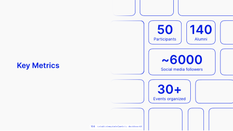

<!-- Generated by scripts/review.py sync. Edit template metadata or review.json. -->

# Four-metric dashboard

Explain values, metrics or relationships using the four-metric dashboard layout.

Model: `metric-dashboard` · Family: Data · Status: **in review**.

[Getting started](../../USING-STUDIO.md) · [All slide guides](../GUIDES.md) · [Current LaTeX source](../../../templates/studio/metric-dashboard.tex)

[Open this slide individually](../index.html?template=metric-dashboard)



The preview shows the shipped defaults. The thin bottom label belongs to the review catalogue.

## Insert this slide

Place this command outside another `frame`:

```latex
\studiotemplate{metric-dashboard}
```

## Change the content

This example uses supported fields. Omitted fields keep their shipped defaults.

```latex
\studiotemplate[
  title={Key Metrics},
  participants-number={50}
]{metric-dashboard}
```

## Complete one-slide example

Create `my-slide.tex` in the project root and paste:

```latex
\documentclass[aspectratio=169]{beamer}
\usetheme{bitpolito-studio}
\usepackage{bitpolitostudiotemplates}
\usepackage[backend=biber]{biblatex}
\addbibresource{bibliography.bib}
\begin{document}
\studiotemplate[
  title={Key Metrics},
  participants-number={50}
]{metric-dashboard}
\end{document}
```

```sh
python3 scripts/build.py my-slide.tex
# Installed TeX alternative:
python3 scripts/build.py my-slide.tex --backend native
```

Output: `build/my-slide.pdf`. On Windows use `py -3` instead of `python3`.

## Editable fields

Positions and available space refer to the original, fixed composition.
In the individual web view, select a field or enable **Show editable areas** to locate it.

| Field | What it changes | Position | Available space | Shipped value |
| --- | --- | --- | --- | --- |
| <code>title</code> | Main text (text) | middle left | 30.9% wide × 8.0% high | <code>Key Metrics</code> |
| <code>participants-number</code> | Editable text (text) | upper right | 14.3% wide × 10.5% high | <code>50</code> |
| <code>participants-caption</code> | Editable text (text) | upper right | 14.3% wide × 4.5% high | <code>Participants</code> |
| <code>alumni-number</code> | Editable text (text) | upper right | 12.4% wide × 10.5% high | <code>140</code> |
| <code>alumni-caption</code> | Editable text (text) | upper right | 12.4% wide × 4.5% high | <code>Alumni</code> |
| <code>followers-number</code> | Editable text (text) | middle right | 28.7% wide × 10.5% high | <code>\textasciitilde6000</code> |
| <code>followers-caption</code> | Editable text (text) | middle right | 28.7% wide × 4.5% high | <code>Social media followers</code> |
| <code>events-number</code> | Editable text (text) | lower right | 18.1% wide × 10.5% high | <code>30+</code> |
| <code>events-caption</code> | Editable text (text) | lower right | 18.1% wide × 4.5% high | <code>Events organized</code> |

Truncated values are shown in full at the start of the current source file.
A text field accepts LaTeX; a graphic field accepts an icon, `\includegraphics`, TikZ or math.

## Keep the composition

- Keep replacements within their allocated boxes. Shorten text or use explicit `\\` line breaks.
- Use `field={}` to hide content while retaining its space.
- Fonts, anchors and geometry remain fixed; unknown fields and overflowing content produce diagnostics.
- Text colour does not recolour supplied graphics; prepare another asset when its fixed colours must change.
- Some diagrams, QR codes and decorations are native source elements rather than configurable fields.
- For structural changes, edit [the current source](../../../templates/studio/metric-dashboard.tex). Catalogues and the showcase reuse it.

## Review

Reference: figma-1006.

Review margins, text, crops, shadows and optical balance using this stable model ID.
Record feedback in [the review ledger](../../../templates/review.json). Compilation is not graphical approval.
