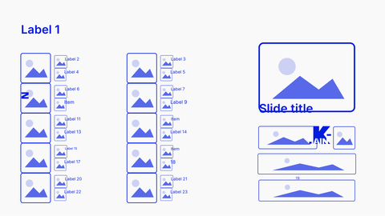

<!-- Generated by scripts/review.py sync. Edit template metadata or review.json. -->

# Media grid

Build a visual explanation around images using the media grid layout.

Model: `partner-media-grid` · Family: Images · Status: **in review**.

[Getting started](../../USING-STUDIO.md) · [All slide guides](../GUIDES.md) · [Content API](../../STUDIO-CONTENT.md) · [Current LaTeX source](../../../templates/studio/partner-media-grid.tex)

[Open this slide individually](../../slides/index.html?template=partner-media-grid)



The preview shows the shipped defaults. The thin bottom label belongs to the review catalogue.

## Grouped model

[Model variants and named fields](../models/partner-media-grid.md)

```latex
\studiotemplate[variant=default,palette=light]{partner-media-grid}
```

Named fields are coherent across related variants. All old fields and numbered slots remain available.

Numeric defaults and charts are illustrative.

## Typed content slots

Use `text/N` for text, `icon/N` for an icon name, `image/N` for an image path,
and `graphic/N` for LaTeX graphics. Numbers are local to this model and stored
in its metadata; the map below shows their positions. Supplied graphics are fitted
proportionally. Text fonts and alignment remain fixed.

Use `clear=text` to remove shipped copy before adding your own; option order does not matter.
Omitted fields keep their defaults. Named aliases such as `text/title` also work.

| Public slot | Existing field | Content and appearance |
| --- | --- | --- |
| `icon/1`, `image/1`, `graphic/1` | `graphic-1` | Replaces this complete graphic; other elements stay fixed. |
| `icon/28`, `image/28`, `graphic/28` | `graphic-2` | Replaces this complete graphic; other elements stay fixed. |
| `icon/20`, `image/20`, `graphic/20` | `graphic-3` | Replaces this complete graphic; other elements stay fixed. |
| `icon/21`, `image/21`, `graphic/21` | `graphic-4` | Replaces this complete graphic; other elements stay fixed. |
| `icon/33`, `image/33`, `graphic/33` | `graphic-5` | Replaces this complete graphic; other elements stay fixed. |
| `icon/2`, `image/2`, `graphic/2` | `graphic-6` | Replaces this complete graphic; other elements stay fixed. |
| `icon/3`, `image/3`, `graphic/3` | `graphic-7` | Replaces this complete graphic; other elements stay fixed. |
| `icon/6`, `image/6`, `graphic/6` | `graphic-8` | Replaces this complete graphic; other elements stay fixed. |
| `icon/4`, `image/4`, `graphic/4` | `graphic-9` | Replaces this complete graphic; other elements stay fixed. |
| `icon/5`, `image/5`, `graphic/5` | `graphic-10` | Replaces this complete graphic; other elements stay fixed. |
| `icon/7`, `image/7`, `graphic/7` | `graphic-11` | Replaces this complete graphic; other elements stay fixed. |
| `icon/8`, `image/8`, `graphic/8` | `graphic-12` | Replaces this complete graphic; other elements stay fixed. |
| `icon/9`, `image/9`, `graphic/9` | `graphic-13` | Replaces this complete graphic; other elements stay fixed. |
| `icon/12`, `image/12`, `graphic/12` | `graphic-14` | Replaces this complete graphic; other elements stay fixed. |
| `icon/10`, `image/10`, `graphic/10` | `graphic-15` | Replaces this complete graphic; other elements stay fixed. |
| `icon/11`, `image/11`, `graphic/11` | `graphic-16` | Replaces this complete graphic; other elements stay fixed. |
| `icon/13`, `image/13`, `graphic/13` | `graphic-17` | Replaces this complete graphic; other elements stay fixed. |
| `icon/14`, `image/14`, `graphic/14` | `graphic-18` | Replaces this complete graphic; other elements stay fixed. |
| `icon/15`, `image/15`, `graphic/15` | `graphic-19` | Replaces this complete graphic; other elements stay fixed. |
| `icon/18`, `image/18`, `graphic/18` | `graphic-20` | Replaces this complete graphic; other elements stay fixed. |
| `icon/16`, `image/16`, `graphic/16` | `graphic-21` | Replaces this complete graphic; other elements stay fixed. |
| `icon/17`, `image/17`, `graphic/17` | `graphic-22` | Replaces this complete graphic; other elements stay fixed. |
| `icon/19`, `image/19`, `graphic/19` | `graphic-23` | Replaces this complete graphic; other elements stay fixed. |
| `icon/22`, `image/22`, `graphic/22` | `graphic-24` | Replaces this complete graphic; other elements stay fixed. |
| `icon/24`, `image/24`, `graphic/24` | `graphic-25` | Replaces this complete graphic; other elements stay fixed. |
| `icon/26`, `image/26`, `graphic/26` | `graphic-26` | Replaces this complete graphic; other elements stay fixed. |
| `icon/23`, `image/23`, `graphic/23` | `graphic-27` | Replaces this complete graphic; other elements stay fixed. |
| `icon/25`, `image/25`, `graphic/25` | `graphic-28` | Replaces this complete graphic; other elements stay fixed. |
| `icon/27`, `image/27`, `graphic/27` | `graphic-29` | Replaces this complete graphic; other elements stay fixed. |
| `icon/29`, `image/29`, `graphic/29` | `graphic-30` | Replaces this complete graphic; other elements stay fixed. |
| `icon/30`, `image/30`, `graphic/30` | `graphic-31` | Replaces this complete graphic; other elements stay fixed. |
| `icon/34`, `image/34`, `graphic/34` | `graphic-32` | Replaces this complete graphic; other elements stay fixed. |
| `icon/31`, `image/31`, `graphic/31` | `graphic-33` | Replaces this complete graphic; other elements stay fixed. |
| `icon/32`, `image/32`, `graphic/32` | `graphic-34` | Replaces this complete graphic; other elements stay fixed. |
| `icon/35`, `image/35`, `graphic/35` | `graphic-35` | Replaces this complete graphic; other elements stay fixed. |
| `text/10` | `title` | Main text |
| `text/19` | `item-2-1` | List or contents entry |
| `text/24` | `item-2-2` | List or contents entry |
| `text/1` | `text-3` | Editable text |
| `text/2` | `text-4` | Editable text |
| `text/4` | `text-5` | Editable text |
| `text/3` | `text-6` | Editable text |
| `text/5` | `text-7` | Editable text |
| `text/6` | `text-8` | Editable text |
| `text/8` | `text-9` | Editable text |
| `text/7` | `text-10` | Editable text |
| `text/9` | `text-11` | Editable text |
| `text/11` | `text-12` | Editable text |
| `text/13` | `text-13` | Editable text |
| `text/12` | `text-14` | Editable text |
| `text/14` | `text-15` | Editable text |
| `text/15` | `text-16` | Editable text |
| `text/17` | `text-17` | Editable text |
| `text/16` | `text-18` | Editable text |
| `text/18` | `text-19` | Editable text |
| `text/20` | `text-20` | Editable text |
| `text/22` | `text-21` | Editable text |
| `text/21` | `text-22` | Editable text |
| `text/23` | `text-23` | Editable text |

Original unscoped field names remain compatible. For a labelled block, changing
`text/N` replaces the complete box; use `heading/N` and `body/N` for structured edits.

## Insert this slide

Place this command outside another `frame`:

```latex
\studiotemplate{partner-media-grid}
```

## Change the content

This example uses supported fields. Omitted fields keep their shipped defaults.

```latex
\studiotemplate[
  text/10={Slide title},
  text/19={19}
]{partner-media-grid}
```

## Complete one-slide example

Create `my-slide.tex` in the project root and paste:

```latex
\documentclass[aspectratio=169]{beamer}
\usetheme{bitpolito-studio}
\usepackage{bitpolitostudiotemplates}
\usepackage[backend=biber]{biblatex}
\addbibresource{bibliography.bib}
\begin{document}
\studiotemplate[
  text/10={Slide title},
  text/19={19}
]{partner-media-grid}
\end{document}
```

```sh
python3 scripts/build.py my-slide.tex
# Installed TeX alternative:
python3 scripts/build.py my-slide.tex --backend native
```

Output: `build/my-slide.pdf`. On Windows use `py -3` instead of `python3`.

## Editable fields

Positions and available space refer to the original, fixed composition.
In the individual web view, select a field or enable **Show editable areas** to locate it.

| Field | What it changes | Position | Available space | Shipped value |
| --- | --- | --- | --- | --- |
| <code>graphic-1</code> | Complete graphic, image or decoration (graphic) | middle right | 25.7% wide × 33.4% high | <code>\studiopaletteimage[width=915\studiounit]{images/studio/neutral/partner-media-grid-graphic-1.pdf}</code> |
| <code>graphic-2</code> | Complete graphic, image or decoration (graphic) | lower right | 25.7% wide × 10.0% high | <code>\studiopaletteimage[width=915\studiounit]{images/studio/neutral/partner-media-grid-graphic-2.pdf}</code> |
| <code>graphic-3</code> | Complete graphic, image or decoration (graphic) | middle right | 15.5% wide × 10.9% high | <code>\studiopaletteimage[width=550\studiounit]{images/studio/neutral/partner-media-grid-graphic-3.pdf}</code> |
| <code>graphic-4</code> | Complete graphic, image or decoration (graphic) | middle right | 5.9% wide × 10.9% high | <code>\studiopaletteimage[width=210\studiounit]{images/studio/neutral/partner-media-grid-graphic-4.pdf}</code> |
| <code>graphic-5</code> | Complete graphic, image or decoration (graphic) | lower right | 25.3% wide × 10.2% high | <code>\studiopaletteimage[width=899\studiounit]{images/studio/neutral/partner-media-grid-graphic-5.pdf}</code> |
| <code>graphic-6</code> | Complete graphic, image or decoration (graphic) | upper left | 8.1% wide × 14.4% high | <code>\studiopaletteimage[width=289\studiounit]{images/studio/neutral/partner-media-grid-graphic-6.pdf}</code> |
| <code>graphic-7</code> | Complete graphic, image or decoration (graphic) | upper left | 3.4% wide × 6.1% high | <code>\studiopaletteimage[width=122\studiounit]{images/studio/neutral/partner-media-grid-graphic-7.pdf}</code> |
| <code>graphic-8</code> | Complete graphic, image or decoration (graphic) | middle left | 3.2% wide × 6.1% high | <code>\studiopaletteimage[width=113\studiounit]{images/studio/neutral/partner-media-grid-graphic-8.pdf}</code> |
| <code>graphic-9</code> | Complete graphic, image or decoration (graphic) | upper centre | 8.1% wide × 14.4% high | <code>\studiopaletteimage[width=289\studiounit]{images/studio/neutral/partner-media-grid-graphic-9.pdf}</code> |
| <code>graphic-10</code> | Complete graphic, image or decoration (graphic) | upper centre | 3.4% wide × 6.1% high | <code>\studiopaletteimage[width=122\studiounit]{images/studio/neutral/partner-media-grid-graphic-10.pdf}</code> |
| <code>graphic-11</code> | Complete graphic, image or decoration (graphic) | middle centre | 3.2% wide × 6.1% high | <code>\studiopaletteimage[width=113\studiounit]{images/studio/neutral/partner-media-grid-graphic-11.pdf}</code> |
| <code>graphic-12</code> | Complete graphic, image or decoration (graphic) | middle left | 8.1% wide × 14.4% high | <code>\studiopaletteimage[width=289\studiounit]{images/studio/neutral/partner-media-grid-graphic-12.pdf}</code> |
| <code>graphic-13</code> | Complete graphic, image or decoration (graphic) | middle left | 3.4% wide × 6.1% high | <code>\studiopaletteimage[width=122\studiounit]{images/studio/neutral/partner-media-grid-graphic-13.pdf}</code> |
| <code>graphic-14</code> | Complete graphic, image or decoration (graphic) | middle left | 3.2% wide × 6.1% high | <code>\studiopaletteimage[width=113\studiounit]{images/studio/neutral/partner-media-grid-graphic-14.pdf}</code> |
| <code>graphic-15</code> | Complete graphic, image or decoration (graphic) | middle centre | 8.1% wide × 14.4% high | <code>\studiopaletteimage[width=289\studiounit]{images/studio/neutral/partner-media-grid-graphic-15.pdf}</code> |
| <code>graphic-16</code> | Complete graphic, image or decoration (graphic) | middle centre | 3.4% wide × 6.1% high | <code>\studiopaletteimage[width=122\studiounit]{images/studio/neutral/partner-media-grid-graphic-16.pdf}</code> |
| <code>graphic-17</code> | Complete graphic, image or decoration (graphic) | middle centre | 3.2% wide × 6.1% high | <code>\studiopaletteimage[width=113\studiounit]{images/studio/neutral/partner-media-grid-graphic-17.pdf}</code> |
| <code>graphic-18</code> | Complete graphic, image or decoration (graphic) | middle left | 8.1% wide × 14.5% high | <code>\studiopaletteimage[width=289\studiounit]{images/studio/neutral/partner-media-grid-graphic-18.pdf}</code> |
| <code>graphic-19</code> | Complete graphic, image or decoration (graphic) | middle left | 3.4% wide × 6.1% high | <code>\studiopaletteimage[width=122\studiounit]{images/studio/neutral/partner-media-grid-graphic-19.pdf}</code> |
| <code>graphic-20</code> | Complete graphic, image or decoration (graphic) | middle left | 3.2% wide × 6.1% high | <code>\studiopaletteimage[width=113\studiounit]{images/studio/neutral/partner-media-grid-graphic-20.pdf}</code> |
| <code>graphic-21</code> | Complete graphic, image or decoration (graphic) | middle centre | 8.1% wide × 14.5% high | <code>\studiopaletteimage[width=289\studiounit]{images/studio/neutral/partner-media-grid-graphic-21.pdf}</code> |
| <code>graphic-22</code> | Complete graphic, image or decoration (graphic) | middle centre | 3.4% wide × 6.1% high | <code>\studiopaletteimage[width=122\studiounit]{images/studio/neutral/partner-media-grid-graphic-22.pdf}</code> |
| <code>graphic-23</code> | Complete graphic, image or decoration (graphic) | middle centre | 3.2% wide × 6.1% high | <code>\studiopaletteimage[width=113\studiounit]{images/studio/neutral/partner-media-grid-graphic-23.pdf}</code> |
| <code>graphic-24</code> | Complete graphic, image or decoration (graphic) | lower left | 8.1% wide × 14.4% high | <code>\studiopaletteimage[width=289\studiounit]{images/studio/neutral/partner-media-grid-graphic-24.pdf}</code> |
| <code>graphic-25</code> | Complete graphic, image or decoration (graphic) | lower left | 3.4% wide × 6.1% high | <code>\studiopaletteimage[width=122\studiounit]{images/studio/neutral/partner-media-grid-graphic-25.pdf}</code> |
| <code>graphic-26</code> | Complete graphic, image or decoration (graphic) | lower left | 3.2% wide × 6.1% high | <code>\studiopaletteimage[width=113\studiounit]{images/studio/neutral/partner-media-grid-graphic-26.pdf}</code> |
| <code>graphic-27</code> | Complete graphic, image or decoration (graphic) | lower centre | 8.1% wide × 14.4% high | <code>\studiopaletteimage[width=289\studiounit]{images/studio/neutral/partner-media-grid-graphic-27.pdf}</code> |
| <code>graphic-28</code> | Complete graphic, image or decoration (graphic) | lower centre | 3.4% wide × 6.1% high | <code>\studiopaletteimage[width=122\studiounit]{images/studio/neutral/partner-media-grid-graphic-28.pdf}</code> |
| <code>graphic-29</code> | Complete graphic, image or decoration (graphic) | lower centre | 3.2% wide × 6.1% high | <code>\studiopaletteimage[width=113\studiounit]{images/studio/neutral/partner-media-grid-graphic-29.pdf}</code> |
| <code>graphic-30</code> | Complete graphic, image or decoration (graphic) | lower left | 8.1% wide × 14.4% high | <code>\studiopaletteimage[width=289\studiounit]{images/studio/neutral/partner-media-grid-graphic-30.pdf}</code> |
| <code>graphic-31</code> | Complete graphic, image or decoration (graphic) | lower left | 3.4% wide × 6.1% high | <code>\studiopaletteimage[width=122\studiounit]{images/studio/neutral/partner-media-grid-graphic-31.pdf}</code> |
| <code>graphic-32</code> | Complete graphic, image or decoration (graphic) | lower left | 3.2% wide × 6.1% high | <code>\studiopaletteimage[width=113\studiounit]{images/studio/neutral/partner-media-grid-graphic-32.pdf}</code> |
| <code>graphic-33</code> | Complete graphic, image or decoration (graphic) | lower centre | 8.1% wide × 14.4% high | <code>\studiopaletteimage[width=289\studiounit]{images/studio/neutral/partner-media-grid-graphic-33.pdf}</code> |
| <code>graphic-34</code> | Complete graphic, image or decoration (graphic) | lower centre | 3.4% wide × 6.1% high | <code>\studiopaletteimage[width=122\studiounit]{images/studio/neutral/partner-media-grid-graphic-34.pdf}</code> |
| <code>graphic-35</code> | Complete graphic, image or decoration (graphic) | lower centre | 3.2% wide × 6.1% high | <code>\studiopaletteimage[width=113\studiounit]{images/studio/neutral/partner-media-grid-graphic-35.pdf}</code> |
| <code>title</code> | Main text (text) | middle right | 25.8% wide × 7.7% high | <code>Slide title</code> |
| <code>item-2-1</code> | List or contents entry (text) | lower right | 1.5% wide × 2.3% high | <code>19</code> |
| <code>item-2-2</code> | List or contents entry (text) | lower right | 15.4% wide × 2.8% high | <code>Label 24</code> |
| <code>text-3</code> | Editable text (text) | upper left | 39.1% wide × 8.5% high | <code>Label 1</code> |
| <code>text-4</code> | Editable text (text) | upper left | 8.8% wide × 3.0% high | <code>Label 2</code> |
| <code>text-5</code> | Editable text (text) | middle left | 8.7% wide × 3.0% high | <code>Label 4</code> |
| <code>text-6</code> | Editable text (text) | upper centre | 7.1% wide × 2.7% high | <code>Label 3</code> |
| <code>text-7</code> | Editable text (text) | middle centre | 8.2% wide × 2.9% high | <code>Label 5</code> |
| <code>text-8</code> | Editable text (text) | middle left | 6.4% wide × 2.7% high | <code>Label 6</code> |
| <code>text-9</code> | Editable text (text) | middle left | 5.8% wide × 3.2% high | <code>Item</code> |
| <code>text-10</code> | Editable text (text) | middle centre | 10.9% wide × 3.0% high | <code>Label 7</code> |
| <code>text-11</code> | Editable text (text) | middle centre | 7.4% wide × 3.1% high | <code>Label 9</code> |
| <code>text-12</code> | Editable text (text) | middle left | 8.7% wide × 3.1% high | <code>Label 11</code> |
| <code>text-13</code> | Editable text (text) | middle left | 9.6% wide × 3.1% high | <code>Label 13</code> |
| <code>text-14</code> | Editable text (text) | middle centre | 5.1% wide × 3.0% high | <code>Item</code> |
| <code>text-15</code> | Editable text (text) | middle centre | 6.5% wide × 3.0% high | <code>Label 14</code> |
| <code>text-16</code> | Editable text (text) | lower left | 6.4% wide × 2.4% high | <code>Label 15</code> |
| <code>text-17</code> | Editable text (text) | lower left | 8.8% wide × 3.0% high | <code>Label 17</code> |
| <code>text-18</code> | Editable text (text) | lower centre | 3.7% wide × 2.7% high | <code>Item</code> |
| <code>text-19</code> | Editable text (text) | lower centre | 3.9% wide × 3.1% high | <code>18</code> |
| <code>text-20</code> | Editable text (text) | lower left | 9.6% wide × 2.6% high | <code>Label 20</code> |
| <code>text-21</code> | Editable text (text) | lower left | 8.2% wide × 2.9% high | <code>Label 22</code> |
| <code>text-22</code> | Editable text (text) | lower centre | 8.1% wide × 3.0% high | <code>Label 21</code> |
| <code>text-23</code> | Editable text (text) | lower centre | 9.6% wide × 3.0% high | <code>Label 23</code> |

Truncated values are shown in full at the start of the current source file.
A text field accepts LaTeX; a graphic field accepts an icon, `\includegraphics`, TikZ or math.

## Replace a graphic

This example selects an icon by catalogue name; its size and position come from the slot:

```latex
\studiotemplate[
  icon/1={alice}
]{partner-media-grid}
```

Use a numbered slot listed above to target another graphic. Some slots contain a complete
panel, background, screenshot or decoration. Inspect the preview before replacing them.

## Keep the composition

- Keep replacements within their allocated boxes. Shorten text or use explicit `\\` line breaks.
- Use `text/N={}` or `icon/N={}` to hide content while retaining its space; separated card panels stay visible.
- Fonts, anchors and geometry remain fixed; unknown fields and overflowing content produce diagnostics.
- Text colour does not recolour supplied graphics; prepare another asset when its fixed colours must change.
- Some diagrams, QR codes and decorations are native source elements rather than configurable fields.
- For structural changes, edit [the current source](../../../templates/studio/partner-media-grid.tex). Catalogues and the showcase reuse it.

## Review

Reference: figma-0930.

Review margins, text, crops, shadows and optical balance using this stable model ID.
Record feedback in [the review ledger](../../../templates/review.json). Compilation is not graphical approval.
