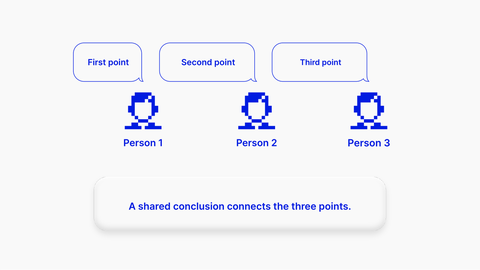

<!-- Generated by scripts/review.py sync. Edit template metadata or review.json. -->

# People Speech Cards

Focus attention on one message using the people speech cards layout.

Model: `people-speech-cards` · Family: Statements · Status: **approved**.

[Getting started](../../USING-STUDIO.md) · [All slide guides](../GUIDES.md) · [Content API](../../STUDIO-CONTENT.md) · [Current LaTeX source](../../../templates/studio/people-speech-cards.tex)

[Open this slide individually](../../slides/index.html?template=people-speech-cards)



The preview shows the shipped defaults. The thin bottom label belongs to the review catalogue.

## Grouped model

[Model variants and named fields](../models/dialogue.md)

```latex
\studiotemplate[variant=cards,palette=light]{dialogue}
```

Use the documented semantic fields or the lower-level numbered slots; replaced semantic names are not retained.

Numeric defaults and charts are illustrative.

## Layout options

| Option | Type | Default | Purpose |
| --- | --- | --- | --- |
| `show-conclusion` | boolean | `true` | Show the concluding callout and its panel without moving the people or messages. |

For example: `\studiotemplate[variant=cards,show-conclusion=false]{dialogue}`. Options are not text slots; invalid values produce an error.

## Typed content slots

Use `text/N` for text, `icon/N` for an icon name, `image/N` for an image path,
and `graphic/N` for LaTeX graphics. Numbers are local to this model and stored
in its metadata; the map below shows their positions. Supplied graphics are fitted
proportionally. Text fonts and alignment remain fixed.

Use `clear=text` to remove shipped copy before adding your own; option order does not matter.
Omitted fields keep their defaults. Named aliases such as `text/title` also work.

| Public slot | Existing field | Content and appearance |
| --- | --- | --- |
| `text/1` | `message-one` | Editable text |
| `text/2` | `message-two` | Editable text |
| `text/3` | `message-three` | Editable text |
| `text/4` | `name-one` | Editable text |
| `text/5` | `name-two` | Editable text |
| `text/6` | `name-three` | Editable text |
| `text/7` | `conclusion` | Editable text |
| `icon/1`, `image/1`, `graphic/1` | `graphic-1` | Replaces this complete graphic; other elements stay fixed. |
| `icon/2`, `image/2`, `graphic/2` | `graphic-2` | Replaces this complete graphic; other elements stay fixed. |
| `icon/3`, `image/3`, `graphic/3` | `graphic-3` | Replaces this complete graphic; other elements stay fixed. |
| `icon/4`, `image/4`, `graphic/4` | `graphic-4` | Replaces this complete graphic; other elements stay fixed. |
| `icon/5`, `image/5`, `graphic/5` | `graphic-5` | Replaces this complete graphic; other elements stay fixed. |
| `icon/6`, `image/6`, `graphic/6` | `graphic-6` | Replaces this complete graphic; other elements stay fixed. |
| `icon/7`, `image/7`, `graphic/7` | `graphic-7` | Replaces this complete graphic; other elements stay fixed. |

Original unscoped field names remain compatible. For a labelled block, changing
`text/N` replaces the complete box; use `heading/N` and `body/N` for structured edits.

## Insert this slide

Place this command outside another `frame`:

```latex
\studiotemplate{people-speech-cards}
```

## Change the content

This example uses supported fields. Omitted fields keep their shipped defaults.

```latex
\studiotemplate[
  text/1={First point},
  text/2={Second point}
]{people-speech-cards}
```

## Complete one-slide example

Create `my-slide.tex` in the project root and paste:

```latex
\documentclass[aspectratio=169]{beamer}
\usetheme{bitpolito-studio}
\usepackage{bitpolitostudiotemplates}
\usepackage[backend=biber]{biblatex}
\addbibresource{bibliography.bib}
\begin{document}
\studiotemplate[
  text/1={First point},
  text/2={Second point}
]{people-speech-cards}
\end{document}
```

```sh
python3 scripts/build.py my-slide.tex
# Installed TeX alternative:
python3 scripts/build.py my-slide.tex --backend native
```

Output: `build/my-slide.pdf`. On Windows use `py -3` instead of `python3`.

## Editable fields

Positions and available space refer to the original, fixed composition.
In the individual web view, select a field or enable **Show editable areas** to locate it.

| Field | What it changes | Position | Available space | Shipped value |
| --- | --- | --- | --- | --- |
| <code>message-one</code> | Editable text (text) | upper left | 12.8% wide × 9.7% high | <code>First point</code> |
| <code>message-two</code> | Editable text (text) | upper centre | 18.6% wide × 9.7% high | <code>Second point</code> |
| <code>message-three</code> | Editable text (text) | upper right | 18.6% wide × 9.7% high | <code>Third point</code> |
| <code>name-one</code> | Editable text (text) | middle left | 13.0% wide × 10.2% high | <code>Person 1</code> |
| <code>name-two</code> | Editable text (text) | middle centre | 13.0% wide × 10.2% high | <code>Person 2</code> |
| <code>name-three</code> | Editable text (text) | middle right | 13.0% wide × 10.2% high | <code>Person 3</code> |
| <code>conclusion</code> | Editable text (text) | lower centre | 55.6% wide × 10.5% high | <code>A shared conclusion connects the three points.</code> |
| <code>graphic-1</code> | Complete graphic, image or decoration (graphic) | upper left | 17.2% wide × 19.1% high | <code>\studiopaletteimage[width=331\studiounit]{images/studio/collection/figma-0765-part-01.pdf}</code> |
| <code>graphic-2</code> | Complete graphic, image or decoration (graphic) | upper centre | 23.0% wide × 19.1% high | <code>\studiopaletteimage[width=441\studiounit]{images/studio/collection/figma-0765-part-02.pdf}</code> |
| <code>graphic-3</code> | Complete graphic, image or decoration (graphic) | upper right | 22.9% wide × 19.1% high | <code>\studiopaletteimage[width=440\studiounit]{images/studio/collection/figma-0765-part-03.pdf}</code> |
| <code>graphic-4</code> | Complete graphic, image or decoration (graphic) | middle left | 7.7% wide × 13.7% high | <code>\includegraphics[trim={0.35900bp 48.20300bp 48.23801bp 0.85500bp},clip,width=148\studiounit,height=148\studiounit,kee...</code> |
| <code>graphic-5</code> | Complete graphic, image or decoration (graphic) | middle centre | 7.7% wide × 13.7% high | <code>\includegraphics[trim={0.98400bp 48.20300bp 48.60899bp 0.85500bp},clip,width=148\studiounit,height=148\studiounit,kee...</code> |
| <code>graphic-6</code> | Complete graphic, image or decoration (graphic) | middle right | 7.7% wide × 13.7% high | <code>\includegraphics[trim={0.75000bp 48.20300bp 48.85201bp 0.85500bp},clip,width=148\studiounit,height=148\studiounit,kee...</code> |
| <code>graphic-7</code> | Complete graphic, image or decoration (graphic) | lower centre | 63.4% wide × 24.5% high | <code>\studiopaletteimage[width=1217\studiounit]{images/studio/collection/figma-0765-part-07.pdf}</code> |

Truncated values are shown in full at the start of the current source file.
A text field accepts LaTeX; a graphic field accepts an icon, `\includegraphics`, TikZ or math.

## Replace a graphic

This example selects an icon by catalogue name; its size and position come from the slot:

```latex
\studiotemplate[
  icon/1={alice}
]{people-speech-cards}
```

Use a numbered slot listed above to target another graphic. Some slots contain a complete
panel, background, screenshot or decoration. Inspect the preview before replacing them.

## Keep the composition

- Keep replacements within their allocated boxes. Shorten text or use explicit `\\` line breaks.
- Use `text/N={}` or `icon/N={}` to hide content while retaining its space; separated card panels stay visible.
- Fonts, anchors and geometry remain fixed; unknown fields and overflowing content produce diagnostics.
- Text colour does not recolour supplied graphics; prepare another asset when its fixed colours must change.
- Some diagrams, QR codes and decorations are native source elements rather than configurable fields.
- For structural changes, edit [the current source](../../../templates/studio/people-speech-cards.tex). Catalogues and the showcase reuse it.

## Review

Reference: figma-0765.

Review margins, text, crops, shadows and optical balance using this stable model ID.
Record feedback in [the review ledger](../../../templates/review.json). Compilation is not graphical approval.
