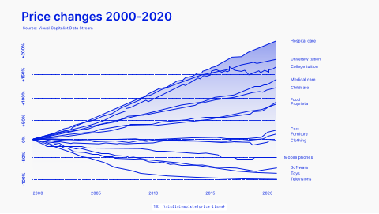

<!-- Generated by scripts/review.py sync. Edit template metadata or review.json. -->

# Price Lines

Explain values, metrics or relationships using the price lines layout.

Model: `price-lines` · Family: Data · Status: **in review**.

[Getting started](../../USING-STUDIO.md) · [All slide guides](../GUIDES.md) · [Content API](../../STUDIO-CONTENT.md) · [Current LaTeX source](../../../templates/studio/price-lines.tex)

[Open this slide individually](../index.html?template=price-lines)



The preview shows the shipped defaults. The thin bottom label belongs to the review catalogue.

## Typed content slots

Use `text/N` for text, `icon/N` for an icon name, `image/N` for an image path,
and `graphic/N` for LaTeX graphics. Numbers are local to this model and stored
in its metadata; the map below shows their positions. Supplied graphics are fitted
proportionally. Text fonts and alignment remain fixed.

Use `clear=text` to remove shipped copy before adding your own; option order does not matter.
Omitted fields keep their defaults. Named aliases such as `text/title` also work.

| Public slot | Existing field | Content and appearance |
| --- | --- | --- |
| `icon/7`, `image/7`, `graphic/7` | `graphic-1` | Replaces this complete graphic; other elements stay fixed. |
| `icon/8`, `image/8`, `graphic/8` | `graphic-2` | Replaces this complete graphic; other elements stay fixed. |
| `icon/6`, `image/6`, `graphic/6` | `graphic-3` | Replaces this complete graphic; other elements stay fixed. |
| `icon/5`, `image/5`, `graphic/5` | `graphic-4` | Replaces this complete graphic; other elements stay fixed. |
| `icon/4`, `image/4`, `graphic/4` | `graphic-5` | Replaces this complete graphic; other elements stay fixed. |
| `icon/3`, `image/3`, `graphic/3` | `graphic-6` | Replaces this complete graphic; other elements stay fixed. |
| `icon/1`, `image/1`, `graphic/1` | `graphic-7` | Replaces this complete graphic; other elements stay fixed. |
| `icon/2`, `image/2`, `graphic/2` | `graphic-8` | Replaces this complete graphic; other elements stay fixed. |
| `text/1` | `title` | Main text |
| `text/4` | `text-2` | Editable text |
| `text/3` | `text-3` | Editable text |
| `text/5` | `text-4` | Editable text |
| `text/6` | `text-5` | Editable text |
| `text/7` | `text-6` | Editable text |
| `text/8` | `text-7` | Editable text |
| `text/9` | `text-8` | Editable text |
| `text/10` | `text-9` | Editable text |
| `text/12` | `text-10` | Editable text |
| `text/14` | `text-11` | Editable text |
| `text/16` | `text-12` | Editable text |
| `text/13` | `text-13` | Editable text |
| `text/11` | `text-14` | Editable text |
| `text/15` | `text-15` | Editable text |
| `text/17` | `text-16` | Editable text |
| `text/18` | `text-17` | Editable text |
| `text/19` | `text-18` | Editable text |
| `text/20` | `text-19` | Editable text |
| `text/21` | `text-20` | Editable text |
| `text/2` | `text-21` | Editable text |

Original unscoped field names remain compatible. For a labelled block, changing
`text/N` replaces the complete box; use `heading/N` and `body/N` for structured edits.

## Insert this slide

Place this command outside another `frame`:

```latex
\studiotemplate{price-lines}
```

## Change the content

This example uses supported fields. Omitted fields keep their shipped defaults.

```latex
\studiotemplate[
  text/1={Price changes 2000-2020},
  text/4={University tuition}
]{price-lines}
```

## Complete one-slide example

Create `my-slide.tex` in the project root and paste:

```latex
\documentclass[aspectratio=169]{beamer}
\usetheme{bitpolito-studio}
\usepackage{bitpolitostudiotemplates}
\usepackage[backend=biber]{biblatex}
\addbibresource{bibliography.bib}
\begin{document}
\studiotemplate[
  text/1={Price changes 2000-2020},
  text/4={University tuition}
]{price-lines}
\end{document}
```

```sh
python3 scripts/build.py my-slide.tex
# Installed TeX alternative:
python3 scripts/build.py my-slide.tex --backend native
```

Output: `build/my-slide.pdf`. On Windows use `py -3` instead of `python3`.

## Editable fields

Positions and available space refer to the original, fixed composition.
In the individual web view, select a field or enable **Show editable areas** to locate it.

| Field | What it changes | Position | Available space | Shipped value |
| --- | --- | --- | --- | --- |
| <code>graphic-1</code> | Complete graphic, image or decoration (graphic) | lower left | 2.2% wide × 7.6% high | <code>\includegraphics[width=80\studiounit]{images/studio/collection/figma-0016-part-01.pdf}</code> |
| <code>graphic-2</code> | Complete graphic, image or decoration (graphic) | lower left | 2.2% wide × 8.6% high | <code>\includegraphics[width=80\studiounit]{images/studio/collection/figma-0016-part-02.pdf}</code> |
| <code>graphic-3</code> | Complete graphic, image or decoration (graphic) | middle left | 2.2% wide × 5.5% high | <code>\includegraphics[width=80\studiounit]{images/studio/collection/figma-0016-part-03.pdf}</code> |
| <code>graphic-4</code> | Complete graphic, image or decoration (graphic) | middle left | 2.2% wide × 8.0% high | <code>\includegraphics[width=80\studiounit]{images/studio/collection/figma-0016-part-04.pdf}</code> |
| <code>graphic-5</code> | Complete graphic, image or decoration (graphic) | middle left | 2.2% wide × 9.0% high | <code>\includegraphics[width=80\studiounit]{images/studio/collection/figma-0016-part-05.pdf}</code> |
| <code>graphic-6</code> | Complete graphic, image or decoration (graphic) | middle left | 2.2% wide × 8.9% high | <code>\includegraphics[width=80\studiounit]{images/studio/collection/figma-0016-part-06.pdf}</code> |
| <code>graphic-7</code> | Complete graphic, image or decoration (graphic) | upper left | 2.2% wide × 9.3% high | <code>\includegraphics[width=80\studiounit]{images/studio/collection/figma-0016-part-07.pdf}</code> |
| <code>graphic-8</code> | Complete graphic, image or decoration (graphic) | middle centre | 65.9% wide × 67.6% high | <code>\includegraphics[width=2344\studiounit]{images/studio/collection/figma-0016-part-08.pdf}</code> |
| <code>title</code> | Main text (text) | upper left | 51.6% wide × 8.6% high | <code>Price changes 2000-2020</code> |
| <code>text-2</code> | Editable text (text) | upper right | 12.3% wide × 2.6% high | <code>University tuition</code> |
| <code>text-3</code> | Editable text (text) | upper right | 9.5% wide × 3.0% high | <code>Hospital care</code> |
| <code>text-4</code> | Editable text (text) | upper right | 13.4% wide × 3.0% high | <code>College tuition</code> |
| <code>text-5</code> | Editable text (text) | middle right | 7.9% wide × 2.7% high | <code>Medical care</code> |
| <code>text-6</code> | Editable text (text) | middle right | 4.7% wide × 2.6% high | <code>Childcare</code> |
| <code>text-7</code> | Editable text (text) | middle right | 6.0% wide × 2.6% high | <code>Food</code> |
| <code>text-8</code> | Editable text (text) | middle right | 5.4% wide × 3.0% high | <code>Proprieta</code> |
| <code>text-9</code> | Editable text (text) | middle right | 6.3% wide × 2.6% high | <code>Cars</code> |
| <code>text-10</code> | Editable text (text) | middle right | 4.4% wide × 2.6% high | <code>Furniture</code> |
| <code>text-11</code> | Editable text (text) | lower right | 5.4% wide × 2.7% high | <code>Software</code> |
| <code>text-12</code> | Editable text (text) | lower right | 5.5% wide × 2.6% high | <code>Televisions</code> |
| <code>text-13</code> | Editable text (text) | lower right | 8.7% wide × 2.7% high | <code>Mobile phones</code> |
| <code>text-14</code> | Editable text (text) | middle right | 8.3% wide × 3.0% high | <code>Clothing</code> |
| <code>text-15</code> | Editable text (text) | lower right | 5.7% wide × 2.7% high | <code>Toys</code> |
| <code>text-16</code> | Editable text (text) | lower left | 3.6% wide × 2.7% high | <code>2000</code> |
| <code>text-17</code> | Editable text (text) | lower left | 3.6% wide × 2.7% high | <code>2005</code> |
| <code>text-18</code> | Editable text (text) | lower centre | 3.4% wide × 2.7% high | <code>2010</code> |
| <code>text-19</code> | Editable text (text) | lower centre | 3.4% wide × 2.7% high | <code>2015</code> |
| <code>text-20</code> | Editable text (text) | lower right | 3.5% wide × 2.7% high | <code>2020</code> |
| <code>text-21</code> | Editable text (text) | upper left | 19.1% wide × 3.0% high | <code>Source: Visual Capitalist Data Stream</code> |

Truncated values are shown in full at the start of the current source file.
A text field accepts LaTeX; a graphic field accepts an icon, `\includegraphics`, TikZ or math.

## Replace a graphic

This example selects an icon by catalogue name; its size and position come from the slot:

```latex
\studiotemplate[
  icon/1={alice}
]{price-lines}
```

Use a numbered slot listed above to target another graphic. Some slots contain a complete
panel, background, screenshot or decoration. Inspect the preview before replacing them.

## Keep the composition

- Keep replacements within their allocated boxes. Shorten text or use explicit `\\` line breaks.
- Use `text/N={}` or `icon/N={}` to hide content while retaining its space; separated card panels stay visible.
- Fonts, anchors and geometry remain fixed; unknown fields and overflowing content produce diagnostics.
- Text colour does not recolour supplied graphics; prepare another asset when its fixed colours must change.
- Some diagrams, QR codes and decorations are native source elements rather than configurable fields.
- For structural changes, edit [the current source](../../../templates/studio/price-lines.tex). Catalogues and the showcase reuse it.

## Review

Reference: figma-0016.

Review margins, text, crops, shadows and optical balance using this stable model ID.
Record feedback in [the review ledger](../../../templates/review.json). Compilation is not graphical approval.
