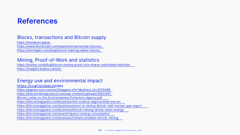

<!-- Generated by scripts/review.py sync. Edit template metadata or review.json. -->

# Bibliography and resources

Present technical content in a measured composition using the bibliography and resources layout.

Model: `references` · Family: Technical · Status: **in review**.

[Getting started](../../USING-STUDIO.md) · [All slide guides](../GUIDES.md) · [Content API](../../STUDIO-CONTENT.md) · [Current LaTeX source](../../../templates/studio/references.tex)

[Open this slide individually](../index.html?template=references)



The preview shows the shipped defaults. The thin bottom label belongs to the review catalogue.

## Typed content slots

Use `text/N` for text, `icon/N` for an icon name, `image/N` for an image path,
and `graphic/N` for LaTeX graphics. Numbers are local to this model and stored
in its metadata; the map below shows their positions. Supplied graphics are fitted
proportionally. Text fonts and alignment remain fixed.

Use `clear=text` to remove shipped copy before adding your own; option order does not matter.
Omitted fields keep their defaults. Named aliases such as `text/title` also work.

| Public slot | Existing field | Content and appearance |
| --- | --- | --- |
| `icon/1`, `image/1`, `graphic/1` | `graphic-1` | Replaces this complete graphic; other elements stay fixed. |
| `icon/2`, `image/2`, `graphic/2` | `graphic-2` | Replaces this complete graphic; other elements stay fixed. |
| `icon/3`, `image/3`, `graphic/3` | `graphic-3` | Replaces this complete graphic; other elements stay fixed. |
| `text/2` | `item-1-1` | List or contents entry |
| `text/3` | `item-1-2` | List or contents entry |
| `text/4` | `item-1-3` | List or contents entry |
| `text/5` | `item-1-4` | List or contents entry |
| `text/6` | `item-1-5` | List or contents entry |
| `text/7` | `item-1-6` | List or contents entry |
| `text/8` | `item-1-7` | List or contents entry |
| `text/9` | `item-1-8` | List or contents entry |
| `text/10` | `item-1-9` | List or contents entry |
| `text/11` | `item-1-10` | List or contents entry |
| `text/12` | `item-1-11` | List or contents entry |
| `text/13` | `item-1-12` | List or contents entry |
| `text/14` | `item-1-13` | List or contents entry |
| `text/15` | `item-1-14` | List or contents entry |
| `text/16` | `item-1-15` | List or contents entry |
| `text/17` | `item-1-16` | List or contents entry |
| `text/18` | `item-1-17` | List or contents entry |
| `text/1` | `title` | Main text |

Original unscoped field names remain compatible. For a labelled block, changing
`text/N` replaces the complete box; use `heading/N` and `body/N` for structured edits.

## Insert this slide

Place this command outside another `frame`:

```latex
\studiotemplate{references}
```

## Change the content

This example uses supported fields. Omitted fields keep their shipped defaults.

```latex
\studiotemplate[
  text/1={References},
  text/2={Blocks, transactions and Bitcoin supply}
]{references}
```

## Complete one-slide example

Create `my-slide.tex` in the project root and paste:

```latex
\documentclass[aspectratio=169]{beamer}
\usetheme{bitpolito-studio}
\usepackage{bitpolitostudiotemplates}
\usepackage[backend=biber]{biblatex}
\addbibresource{bibliography.bib}
\begin{document}
\studiotemplate[
  text/1={References},
  text/2={Blocks, transactions and Bitcoin supply}
]{references}
\end{document}
```

```sh
python3 scripts/build.py my-slide.tex
# Installed TeX alternative:
python3 scripts/build.py my-slide.tex --backend native
```

Output: `build/my-slide.pdf`. On Windows use `py -3` instead of `python3`.

## Editable fields

Positions and available space refer to the original, fixed composition.
In the individual web view, select a field or enable **Show editable areas** to locate it.

| Field | What it changes | Position | Available space | Shipped value |
| --- | --- | --- | --- | --- |
| <code>graphic-1</code> | Complete graphic, image or decoration (graphic) | upper left | 37.6% wide × 11.4% high | <code>\includegraphics[width=1336\studiounit]{images/studio/collection/figma-0526-part-01.pdf}</code> |
| <code>graphic-2</code> | Complete graphic, image or decoration (graphic) | upper left | 50.4% wide × 8.4% high | <code>\includegraphics[width=1793\studiounit]{images/studio/collection/figma-0526-part-02.pdf}</code> |
| <code>graphic-3</code> | Complete graphic, image or decoration (graphic) | middle left | 56.0% wide × 29.4% high | <code>\includegraphics[width=1990\studiounit]{images/studio/collection/figma-0526-part-03.pdf}</code> |
| <code>item-1-1</code> | List or contents entry (text) | upper left | 37.7% wide × 5.7% high | <code>Blocks, transactions and Bitcoin supply</code> |
| <code>item-1-2</code> | List or contents entry (text) | upper left | 15.3% wide × 3.5% high | <code>https://mempool.space</code> |
| <code>item-1-3</code> | List or contents entry (text) | middle left | 37.2% wide × 3.5% high | <code>https://www.blockchain.com/explorer/charts/total-bitcoins</code> |
| <code>item-1-4</code> | List or contents entry (text) | middle left | 36.6% wide × 3.6% high | <code>https://stormgain.com/blog/bitcoin-halving-dates-history</code> |
| <code>item-1-5</code> | List or contents entry (text) | middle left | 45.1% wide × 5.7% high | <code>Mining, Proof-of-Work and statistics</code> |
| <code>item-1-6</code> | List or contents entry (text) | middle left | 50.0% wide × 3.6% high | <code>https://braiins.com/blog/bitcoin-mining-pools-luck-shares-estimated-hashrate</code> |
| <code>item-1-7</code> | List or contents entry (text) | middle left | 19.7% wide × 3.6% high | <code>https://insights.braiins.com/en</code> |
| <code>item-1-8</code> | List or contents entry (text) | middle left | 39.0% wide × 5.7% high | <code>Energy use and environmental impact</code> |
| <code>item-1-9</code> | List or contents entry (text) | middle left | 19.5% wide × 3.8% high | <code>https://ccaf.io/cbeci/index</code> |
| <code>item-1-10</code> | List or contents entry (text) | lower left | 40.8% wide × 3.6% high | <code>https://papers.ssrn.com/sol3/papers.cfm?abstract\_id=4125499</code> |
| <code>item-1-11</code> | List or contents entry (text) | lower left | 40.8% wide × 3.6% high | <code>https://bitcoinminingcouncil.com/wp-content/uploads/2022/05/</code> |
| <code>item-1-12</code> | List or contents entry (text) | lower left | 39.2% wide × 3.6% high | <code>Bitcoin\_Letter\_to\_the\_Environmental\_Protection\_Agency.pdf</code> |
| <code>item-1-13</code> | List or contents entry (text) | lower left | 46.0% wide × 3.6% high | <code>https://bitcoinmagazine.com/business/not-science-digiconomist-bitcoin</code> |
| <code>item-1-14</code> | List or contents entry (text) | lower centre | 55.5% wide × 3.6% high | <code>https://bitcoinmagazine.com/business/exxon-is-mining-bitcoin-with-excess-gas-report</code> |
| <code>item-1-15</code> | List or contents entry (text) | lower left | 47.4% wide × 3.6% high | <code>https://bitcoinmagazine.com/business/bitcoin-mining-drives-clean-energy</code> |
| <code>item-1-16</code> | List or contents entry (text) | lower left | 41.7% wide × 3.6% high | <code>https://bitcoinmagazine.com/search?query=mining+consumption</code> |
| <code>item-1-17</code> | List or contents entry (text) | lower left | 44.9% wide × 3.6% high | <code>https://bitcoinmagazine.com/business/climate-problem-bitcoin-mining</code> |
| <code>title</code> | Main text (text) | upper left | 17.8% wide × 7.6% high | <code>References</code> |

Truncated values are shown in full at the start of the current source file.
A text field accepts LaTeX; a graphic field accepts an icon, `\includegraphics`, TikZ or math.

## Replace a graphic

This example selects an icon by catalogue name; its size and position come from the slot:

```latex
\studiotemplate[
  icon/1={alice}
]{references}
```

Use a numbered slot listed above to target another graphic. Some slots contain a complete
panel, background, screenshot or decoration. Inspect the preview before replacing them.

## Bibliography

Edit `bibliography.bib` and keep biblatex/Biber enabled as in the complete example.
Citation keys and resource text can be changed through the listed fields or the source.

## Keep the composition

- Keep replacements within their allocated boxes. Shorten text or use explicit `\\` line breaks.
- Use `text/N={}` or `icon/N={}` to hide content while retaining its space; separated card panels stay visible.
- Fonts, anchors and geometry remain fixed; unknown fields and overflowing content produce diagnostics.
- Text colour does not recolour supplied graphics; prepare another asset when its fixed colours must change.
- Some diagrams, QR codes and decorations are native source elements rather than configurable fields.
- For structural changes, edit [the current source](../../../templates/studio/references.tex). Catalogues and the showcase reuse it.

## Review

Reference: figma-0526.

Review margins, text, crops, shadows and optical balance using this stable model ID.
Record feedback in [the review ledger](../../../templates/review.json). Compilation is not graphical approval.
