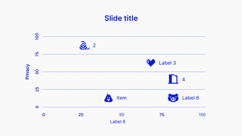

<!-- Generated by scripts/review.py sync. Edit template metadata or review.json. -->

# Two-axis comparison

Explain values, metrics or relationships using the two-axis comparison layout.

Model: `scatter-comparison` · Family: Data · Status: **in review**.

[Getting started](../../USING-STUDIO.md) · [All slide guides](../GUIDES.md) · [Content API](../../STUDIO-CONTENT.md) · [Current LaTeX source](../../../templates/studio/scatter-comparison.tex)

[Open this slide individually](../../slides/index.html?template=scatter-comparison)



The preview shows the shipped defaults. The thin bottom label belongs to the review catalogue.

## Grouped model

[Model variants and named fields](../models/charts.md)

```latex
\studiotemplate[variant=scatter,palette=light]{charts}
```

Named fields are coherent across related variants. All old fields and numbered slots remain available.

Numeric defaults and charts are illustrative.

## Typed content slots

Use `text/N` for text, `icon/N` for an icon name, `image/N` for an image path,
and `graphic/N` for LaTeX graphics. Numbers are local to this model and stored
in its metadata; the map below shows their positions. Supplied graphics are fitted
proportionally. Text fonts and alignment remain fixed.

Use `clear=text` to remove shipped copy before adding your own; option order does not matter.
Omitted fields keep their defaults. Named aliases such as `text/title` also work.

| Public slot | Existing field | Content and appearance |
| --- | --- | --- |
| `icon/9`, `image/9`, `graphic/9` | `graphic-1` | Replaces this complete graphic; other elements stay fixed. |
| `icon/13`, `image/13`, `graphic/13` | `graphic-2` | Replaces this complete graphic; other elements stay fixed. |
| `icon/15`, `image/15`, `graphic/15` | `graphic-3` | Replaces this complete graphic; other elements stay fixed. |
| `icon/16`, `image/16`, `graphic/16` | `graphic-4` | Replaces this complete graphic; other elements stay fixed. |
| `icon/17`, `image/17`, `graphic/17` | `graphic-5` | Replaces this complete graphic; other elements stay fixed. |
| `icon/6`, `image/6`, `graphic/6` | `graphic-6` | Replaces this complete graphic; other elements stay fixed. |
| `icon/4`, `image/4`, `graphic/4` | `graphic-7` | Replaces this complete graphic; other elements stay fixed. |
| `icon/1`, `image/1`, `graphic/1` | `graphic-8` | Replaces this complete graphic; other elements stay fixed. |
| `icon/10`, `image/10`, `graphic/10` | `graphic-9` | Replaces this complete graphic; other elements stay fixed. |
| `icon/14`, `image/14`, `graphic/14` | `graphic-10` | Replaces this complete graphic; other elements stay fixed. |
| `icon/8`, `image/8`, `graphic/8` | `graphic-11` | Replaces this complete graphic; other elements stay fixed. |
| `icon/5`, `image/5`, `graphic/5` | `graphic-12` | Replaces this complete graphic; other elements stay fixed. |
| `icon/2`, `image/2`, `graphic/2` | `graphic-13` | Replaces this complete graphic; other elements stay fixed. |
| `icon/3`, `image/3`, `graphic/3` | `graphic-14` | Replaces this complete graphic; other elements stay fixed. |
| `icon/12`, `image/12`, `graphic/12` | `graphic-15` | Replaces this complete graphic; other elements stay fixed. |
| `icon/11`, `image/11`, `graphic/11` | `graphic-16` | Replaces this complete graphic; other elements stay fixed. |
| `text/7` | `text-1` | Editable text |
| `text/8` | `text-2` | Editable text |
| `icon/7`, `image/7`, `graphic/7` | `axis-label` | Replaces this complete graphic; other elements stay fixed. |
| `text/9` | `text-4` | Editable text |
| `text/1` | `title` | Main text |
| `text/2` | `text-6` | Editable text |
| `text/6` | `text-7` | Editable text |
| `text/5` | `text-8` | Editable text |
| `text/4` | `text-9` | Editable text |
| `text/3` | `text-10` | Editable text |

Original unscoped field names remain compatible. For a labelled block, changing
`text/N` replaces the complete box; use `heading/N` and `body/N` for structured edits.

## Insert this slide

Place this command outside another `frame`:

```latex
\studiotemplate{scatter-comparison}
```

## Change the content

This example uses supported fields. Omitted fields keep their shipped defaults.

```latex
\studiotemplate[
  text/1={Slide title},
  text/7={50}
]{scatter-comparison}
```

## Complete one-slide example

Create `my-slide.tex` in the project root and paste:

```latex
\documentclass[aspectratio=169]{beamer}
\usetheme{bitpolito-studio}
\usepackage{bitpolitostudiotemplates}
\usepackage[backend=biber]{biblatex}
\addbibresource{bibliography.bib}
\begin{document}
\studiotemplate[
  text/1={Slide title},
  text/7={50}
]{scatter-comparison}
\end{document}
```

```sh
python3 scripts/build.py my-slide.tex
# Installed TeX alternative:
python3 scripts/build.py my-slide.tex --backend native
```

Output: `build/my-slide.pdf`. On Windows use `py -3` instead of `python3`.

## Editable fields

Positions and available space refer to the original, fixed composition.
In the individual web view, select a field or enable **Show editable areas** to locate it.

| Field | What it changes | Position | Available space | Shipped value |
| --- | --- | --- | --- | --- |
| <code>graphic-1</code> | Complete graphic, image or decoration (graphic) | lower left | 2.7% wide × 5.9% high | <code>\studiopaletteimage[width=95\studiounit]{images/studio/collection/figma-0371-part-01.pdf}</code> |
| <code>graphic-2</code> | Complete graphic, image or decoration (graphic) | lower left | 2.7% wide × 4.2% high | <code>\studiopaletteimage[width=95\studiounit]{images/studio/collection/figma-0371-part-02.pdf}</code> |
| <code>graphic-3</code> | Complete graphic, image or decoration (graphic) | lower left | 2.3% wide × 4.8% high | <code>\studiopaletteimage[width=83\studiounit]{images/studio/collection/figma-0371-part-03.pdf}</code> |
| <code>graphic-4</code> | Complete graphic, image or decoration (graphic) | lower centre | 3.3% wide × 4.8% high | <code>\studiopaletteimage[width=118\studiounit]{images/studio/collection/figma-0371-part-04.pdf}</code> |
| <code>graphic-5</code> | Complete graphic, image or decoration (graphic) | lower right | 3.3% wide × 4.7% high | <code>\studiopaletteimage[width=117\studiounit]{images/studio/collection/figma-0371-part-05.pdf}</code> |
| <code>graphic-6</code> | Complete graphic, image or decoration (graphic) | middle left | 3.1% wide × 13.7% high | <code>\studiopaletteimage[width=112\studiounit]{images/studio/collection/figma-0371-part-06.pdf}</code> |
| <code>graphic-7</code> | Complete graphic, image or decoration (graphic) | middle left | 2.6% wide × 5.9% high | <code>\studiopaletteimage[width=94\studiounit]{images/studio/collection/figma-0371-part-07.pdf}</code> |
| <code>graphic-8</code> | Complete graphic, image or decoration (graphic) | upper left | 2.7% wide × 7.5% high | <code>\studiopaletteimage[width=95\studiounit]{images/studio/collection/figma-0371-part-08.pdf}</code> |
| <code>graphic-9</code> | Complete graphic, image or decoration (graphic) | lower centre | 69.0% wide × 2.6% high | <code>\studiopaletteimage[width=2452\studiounit]{images/studio/collection/figma-0371-part-09.pdf}</code> |
| <code>graphic-10</code> | Complete graphic, image or decoration (graphic) | lower centre | 69.2% wide × 2.6% high | <code>\studiopaletteimage[width=2460\studiounit]{images/studio/collection/figma-0371-part-10.pdf}</code> |
| <code>graphic-11</code> | Complete graphic, image or decoration (graphic) | middle centre | 69.0% wide × 2.6% high | <code>\studiopaletteimage[width=2452\studiounit]{images/studio/collection/figma-0371-part-11.pdf}</code> |
| <code>graphic-12</code> | Complete graphic, image or decoration (graphic) | middle centre | 69.0% wide × 2.6% high | <code>\studiopaletteimage[width=2452\studiounit]{images/studio/collection/figma-0371-part-12.pdf}</code> |
| <code>graphic-13</code> | Complete graphic, image or decoration (graphic) | upper centre | 69.0% wide × 2.6% high | <code>\studiopaletteimage[width=2452\studiounit]{images/studio/collection/figma-0371-part-13.pdf}</code> |
| <code>graphic-14</code> | Complete graphic, image or decoration (graphic) | middle centre | 5.6% wide × 8.6% high | <code>\studiopaletteimage[width=198\studiounit]{images/studio/collection/figma-0371-part-14.pdf}</code> |
| <code>graphic-15</code> | Complete graphic, image or decoration (graphic) | lower right | 5.6% wide × 8.6% high | <code>\studiopaletteimage[width=198\studiounit]{images/studio/collection/figma-0371-part-15.pdf}</code> |
| <code>graphic-16</code> | Complete graphic, image or decoration (graphic) | lower centre | 4.8% wide × 8.5% high | <code>\studiopaletteimage[width=170\studiounit]{images/studio/collection/figma-0371-part-16.pdf}</code> |
| <code>text-1</code> | Editable text (text) | lower centre | 3.1% wide × 4.0% high | <code>50</code> |
| <code>text-2</code> | Editable text (text) | lower right | 4.0% wide × 4.0% high | <code>100</code> |
| <code>axis-label</code> | Complete graphic, image or decoration (graphic) | middle left | 1.6% wide × 4.0% high | <code>\studiopaletteimage[width=56\studiounit]{images/studio/collection/figma-0371-axis-label.pdf}</code> |
| <code>text-4</code> | Editable text (text) | lower centre | 10.2% wide × 5.0% high | <code>Label 9</code> |
| <code>title</code> | Main text (text) | upper centre | 29.9% wide × 7.6% high | <code>Slide title</code> |
| <code>text-6</code> | Editable text (text) | middle centre | 5.2% wide × 5.0% high | <code>2</code> |
| <code>text-7</code> | Editable text (text) | lower right | 16.6% wide × 5.0% high | <code>Label 6</code> |
| <code>text-8</code> | Editable text (text) | lower centre | 10.8% wide × 5.6% high | <code>Item</code> |
| <code>text-9</code> | Editable text (text) | middle right | 5.7% wide × 4.9% high | <code>4</code> |
| <code>text-10</code> | Editable text (text) | middle right | 12.4% wide × 5.6% high | <code>Label 3</code> |

Truncated values are shown in full at the start of the current source file.
A text field accepts LaTeX; a graphic field accepts an icon, `\includegraphics`, TikZ or math.

## Replace a graphic

This example selects an icon by catalogue name; its size and position come from the slot:

```latex
\studiotemplate[
  icon/1={alice}
]{scatter-comparison}
```

Use a numbered slot listed above to target another graphic. Some slots contain a complete
panel, background, screenshot or decoration. Inspect the preview before replacing them.

## Keep the composition

- Keep replacements within their allocated boxes. Shorten text or use explicit `\\` line breaks.
- Use `text/N={}` or `icon/N={}` to hide content while retaining its space; separated card panels stay visible.
- Fonts, anchors and geometry remain fixed; unknown fields and overflowing content produce diagnostics.
- Text colour does not recolour supplied graphics; prepare another asset when its fixed colours must change.
- Some diagrams, QR codes and decorations are native source elements rather than configurable fields.
- For structural changes, edit [the current source](../../../templates/studio/scatter-comparison.tex). Catalogues and the showcase reuse it.

## Review

Reference: figma-0371.

Review margins, text, crops, shadows and optical balance using this stable model ID.
Record feedback in [the review ledger](../../../templates/review.json). Compilation is not graphical approval.
