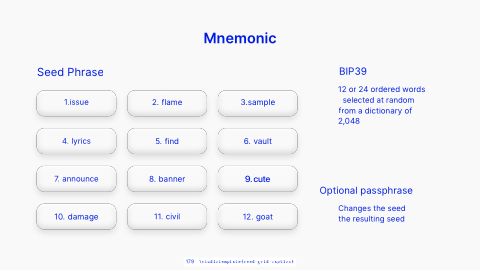

<!-- Generated by scripts/review.py sync. Edit template metadata or review.json. -->

# Seed Grid Caption

Present technical content in a measured composition using the seed grid caption layout.

Model: `seed-grid-caption` · Family: Technical · Status: **in review**.

[Getting started](../../USING-STUDIO.md) · [All slide guides](../GUIDES.md) · [Current LaTeX source](../../../templates/studio/seed-grid-caption.tex)

[Open this slide individually](../index.html?template=seed-grid-caption)



The preview shows the shipped defaults. The thin bottom label belongs to the review catalogue.

## Insert this slide

Place this command outside another `frame`:

```latex
\studiotemplate{seed-grid-caption}
```

## Change the content

This example uses supported fields. Omitted fields keep their shipped defaults.

```latex
\studiotemplate[
  title={Mnemonic},
  item-2-1={BIP39}
]{seed-grid-caption}
```

## Complete one-slide example

Create `my-slide.tex` in the project root and paste:

```latex
\documentclass[aspectratio=169]{beamer}
\usetheme{bitpolito-studio}
\usepackage{bitpolitostudiotemplates}
\usepackage[backend=biber]{biblatex}
\addbibresource{bibliography.bib}
\begin{document}
\studiotemplate[
  title={Mnemonic},
  item-2-1={BIP39}
]{seed-grid-caption}
\end{document}
```

```sh
python3 scripts/build.py my-slide.tex
# Installed TeX alternative:
python3 scripts/build.py my-slide.tex --backend native
```

Output: `build/my-slide.pdf`. On Windows use `py -3` instead of `python3`.

## Editable fields

Positions and available space refer to the original, fixed composition.
In the individual web view, select a field or enable **Show editable areas** to locate it.

| Field | What it changes | Position | Available space | Shipped value |
| --- | --- | --- | --- | --- |
| <code>graphic-1</code> | Replaceable graphic or decoration (graphic) | middle left | 19.1% wide × 14.1% high | <code>\includegraphics[width=678\studiounit]{images/studio/collection/figma-0662-part-01.pdf}</code> |
| <code>graphic-2</code> | Replaceable graphic or decoration (graphic) | middle centre | 19.1% wide × 14.1% high | <code>\includegraphics[width=678\studiounit]{images/studio/collection/figma-0662-part-02.pdf}</code> |
| <code>graphic-3</code> | Replaceable graphic or decoration (graphic) | middle centre | 19.1% wide × 14.1% high | <code>\includegraphics[width=678\studiounit]{images/studio/collection/figma-0662-part-03.pdf}</code> |
| <code>graphic-4</code> | Replaceable graphic or decoration (graphic) | middle left | 19.1% wide × 14.1% high | <code>\includegraphics[width=678\studiounit]{images/studio/collection/figma-0662-part-04.pdf}</code> |
| <code>graphic-5</code> | Replaceable graphic or decoration (graphic) | middle centre | 19.1% wide × 14.1% high | <code>\includegraphics[width=678\studiounit]{images/studio/collection/figma-0662-part-05.pdf}</code> |
| <code>graphic-6</code> | Replaceable graphic or decoration (graphic) | middle centre | 19.1% wide × 14.1% high | <code>\includegraphics[width=678\studiounit]{images/studio/collection/figma-0662-part-06.pdf}</code> |
| <code>graphic-7</code> | Replaceable graphic or decoration (graphic) | lower left | 19.1% wide × 14.1% high | <code>\includegraphics[width=678\studiounit]{images/studio/collection/figma-0662-part-07.pdf}</code> |
| <code>graphic-8</code> | Replaceable graphic or decoration (graphic) | lower centre | 19.1% wide × 14.1% high | <code>\includegraphics[width=678\studiounit]{images/studio/collection/figma-0662-part-08.pdf}</code> |
| <code>graphic-9</code> | Replaceable graphic or decoration (graphic) | lower centre | 19.1% wide × 14.1% high | <code>\includegraphics[width=678\studiounit]{images/studio/collection/figma-0662-part-09.pdf}</code> |
| <code>graphic-10</code> | Replaceable graphic or decoration (graphic) | lower left | 19.1% wide × 14.1% high | <code>\includegraphics[width=678\studiounit]{images/studio/collection/figma-0662-part-10.pdf}</code> |
| <code>graphic-11</code> | Replaceable graphic or decoration (graphic) | lower centre | 19.1% wide × 14.1% high | <code>\includegraphics[width=678\studiounit]{images/studio/collection/figma-0662-part-11.pdf}</code> |
| <code>graphic-12</code> | Replaceable graphic or decoration (graphic) | lower centre | 19.1% wide × 14.1% high | <code>\includegraphics[width=678\studiounit]{images/studio/collection/figma-0662-part-12.pdf}</code> |
| <code>title</code> | Main text (text) | upper centre | 19.2% wide × 7.5% high | <code>Mnemonic</code> |
| <code>item-2-1</code> | List or contents entry (text) | upper right | 7.7% wide × 5.1% high | <code>BIP39</code> |
| <code>item-2-2</code> | List or contents entry (text) | middle right | 28.3% wide × 4.1% high | <code>12 or 24 ordered words</code> |
| <code>item-2-3</code> | List or contents entry (text) | middle right | 28.3% wide × 4.5% high | <code>selected at random</code> |
| <code>item-2-4</code> | List or contents entry (text) | middle right | 15.4% wide × 4.1% high | <code>from a dictionary of</code> |
| <code>item-2-5</code> | List or contents entry (text) | middle right | 10.2% wide × 4.1% high | <code>2,048</code> |
| <code>item-3-1</code> | List or contents entry (text) | lower right | 22.8% wide × 5.6% high | <code>Optional passphrase</code> |
| <code>item-3-2</code> | List or contents entry (text) | lower right | 26.5% wide × 4.6% high | <code>Changes the seed</code> |
| <code>item-3-3</code> | List or contents entry (text) | lower right | 15.1% wide × 4.0% high | <code>the resulting seed</code> |
| <code>text-4</code> | Editable text (text) | upper left | 15.5% wide × 5.7% high | <code>Seed Phrase</code> |
| <code>text-5</code> | Editable text (text) | middle left | 14.9% wide × 4.0% high | <code>1.issue</code> |
| <code>text-6</code> | Editable text (text) | middle left | 14.9% wide × 4.6% high | <code>4. lyrics</code> |
| <code>text-7</code> | Editable text (text) | lower left | 14.9% wide × 4.0% high | <code>7. announce</code> |
| <code>text-8</code> | Editable text (text) | lower left | 14.8% wide × 4.7% high | <code>10. damage</code> |
| <code>text-9</code> | Editable text (text) | middle centre | 14.8% wide × 4.1% high | <code>2. flame</code> |
| <code>text-10</code> | Editable text (text) | middle centre | 14.8% wide × 4.1% high | <code>5. find</code> |
| <code>text-11</code> | Editable text (text) | lower centre | 14.8% wide × 4.1% high | <code>8. banner</code> |
| <code>text-12</code> | Editable text (text) | lower centre | 14.9% wide × 4.0% high | <code>11. civil</code> |
| <code>text-13</code> | Editable text (text) | middle centre | 14.8% wide × 4.6% high | <code>3.sample</code> |
| <code>text-14</code> | Editable text (text) | middle centre | 14.8% wide × 4.1% high | <code>6. vault</code> |
| <code>text-15</code> | Editable text (text) | lower centre | 14.8% wide × 4.6% high | <code>12. goat</code> |

Truncated values are shown in full at the start of the current source file.
A text field accepts LaTeX; a graphic field accepts an icon, `\includegraphics`, TikZ or math.

## Replace a graphic

This example fits an icon inside the first graphic slot, preserving its proportions:

```latex
\studiotemplate[
  graphic-1={\asset[width=0.17160\paperwidth,height=0.12645\paperheight,keepaspectratio]{alice}}
]{seed-grid-caption}
```

Use any graphic field listed above to target another slot. Some slots contain a complete
panel, background, screenshot or decoration. Inspect the preview before replacing them.

## Keep the composition

- Keep replacements within their allocated boxes. Shorten text or use explicit `\\` line breaks.
- Use `field={}` to hide content while retaining its space.
- Fonts, anchors and geometry remain fixed; unknown fields and overflowing content produce diagnostics.
- Text colour does not recolour supplied graphics; prepare another asset when its fixed colours must change.
- Some diagrams, QR codes and decorations are native source elements rather than configurable fields.
- For structural changes, edit [the current source](../../../templates/studio/seed-grid-caption.tex). Catalogues and the showcase reuse it.

## Review

Reference: figma-0662.

Review margins, text, crops, shadows and optical balance using this stable model ID.
Record feedback in [the review ledger](../../../templates/review.json). Compilation is not graphical approval.
