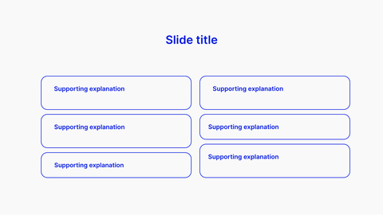

<!-- Generated by scripts/review.py sync. Edit template metadata or review.json. -->

# Six Explanation Cards

Group concepts into a visual set using the six explanation cards layout.

Model: `six-explanation-cards` · Family: Cards · Status: **in review**.

[Getting started](../../USING-STUDIO.md) · [All slide guides](../GUIDES.md) · [Content API](../../STUDIO-CONTENT.md) · [Current LaTeX source](../../../templates/studio/six-explanation-cards.tex)

[Open this slide individually](../../slides/index.html?template=six-explanation-cards)



The preview shows the shipped defaults. The thin bottom label belongs to the review catalogue.

## Grouped model

[Model variants and named fields](../models/text-cards.md)

```latex
\studiotemplate[variant=six-detailed,palette=light]{text-cards}
```

Named fields are coherent across related variants. All old fields and numbered slots remain available.

Numeric defaults and charts are illustrative.

## Typed content slots

Use `text/N` for text, `icon/N` for an icon name, `image/N` for an image path,
and `graphic/N` for LaTeX graphics. Numbers are local to this model and stored
in its metadata; the map below shows their positions. Supplied graphics are fitted
proportionally. Text fonts and alignment remain fixed.

Use `clear=text` to remove shipped copy before adding your own; option order does not matter.
Omitted fields keep their defaults. Named aliases such as `text/title` also work.

| Public slot | Existing field | Content and appearance |
| --- | --- | --- |
| `text/1` | `title` | Main text |
| `text/3` | `text-2` | Editable text |
| `text/5` | `text-3` | Editable text |
| `text/6` | `text-4` | Editable text |
| `text/2` | `text-5` | Editable text |
| `text/4` | `text-6` | Editable text |
| `text/7` | `text-7` | Editable text |

Original unscoped field names remain compatible. For a labelled block, changing
`text/N` replaces the complete box; use `heading/N` and `body/N` for structured edits.

## Insert this slide

Place this command outside another `frame`:

```latex
\studiotemplate{six-explanation-cards}
```

## Change the content

This example uses supported fields. Omitted fields keep their shipped defaults.

```latex
\studiotemplate[
  text/1={Slide title},
  text/3={Supporting explanation}
]{six-explanation-cards}
```

## Complete one-slide example

Create `my-slide.tex` in the project root and paste:

```latex
\documentclass[aspectratio=169]{beamer}
\usetheme{bitpolito-studio}
\usepackage{bitpolitostudiotemplates}
\usepackage[backend=biber]{biblatex}
\addbibresource{bibliography.bib}
\begin{document}
\studiotemplate[
  text/1={Slide title},
  text/3={Supporting explanation}
]{six-explanation-cards}
\end{document}
```

```sh
python3 scripts/build.py my-slide.tex
# Installed TeX alternative:
python3 scripts/build.py my-slide.tex --backend native
```

Output: `build/my-slide.pdf`. On Windows use `py -3` instead of `python3`.

## Editable fields

Positions and available space refer to the original, fixed composition.
In the individual web view, select a field or enable **Show editable areas** to locate it.

| Field | What it changes | Position | Available space | Shipped value |
| --- | --- | --- | --- | --- |
| <code>title</code> | Main text (text) | upper centre | 39.4% wide × 8.5% high | <code>Slide title</code> |
| <code>text-2</code> | Editable text (text) | middle right | 37.7% wide × 8.5% high | <code>Supporting explanation</code> |
| <code>text-3</code> | Editable text (text) | middle right | 36.5% wide × 4.6% high | <code>Supporting explanation</code> |
| <code>text-4</code> | Editable text (text) | lower right | 36.5% wide × 8.5% high | <code>Supporting explanation</code> |
| <code>text-5</code> | Editable text (text) | middle left | 37.7% wide × 7.9% high | <code>Supporting explanation</code> |
| <code>text-6</code> | Editable text (text) | middle left | 35.3% wide × 8.5% high | <code>Supporting explanation</code> |
| <code>text-7</code> | Editable text (text) | lower left | 37.7% wide × 4.5% high | <code>Supporting explanation</code> |

Truncated values are shown in full at the start of the current source file.
A text field accepts LaTeX; a graphic field accepts an icon, `\includegraphics`, TikZ or math.

## Keep the composition

- Keep replacements within their allocated boxes. Shorten text or use explicit `\\` line breaks.
- Use `text/N={}` or `icon/N={}` to hide content while retaining its space; separated card panels stay visible.
- Fonts, anchors and geometry remain fixed; unknown fields and overflowing content produce diagnostics.
- Text colour does not recolour supplied graphics; prepare another asset when its fixed colours must change.
- Some diagrams, QR codes and decorations are native source elements rather than configurable fields.
- For structural changes, edit [the current source](../../../templates/studio/six-explanation-cards.tex). Catalogues and the showcase reuse it.

## Review

Reference: figma-1016.

Review margins, text, crops, shadows and optical balance using this stable model ID.
Record feedback in [the review ledger](../../../templates/review.json). Compilation is not graphical approval.
