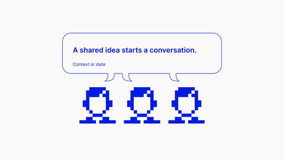

<!-- Generated by scripts/review.py sync. Edit template metadata or review.json. -->

# Speech panel over three people

Focus attention on one message using the speech panel over three people layout.

Model: `speech-panel` · Family: Statements · Status: **approved**.

[Getting started](../../USING-STUDIO.md) · [All slide guides](../GUIDES.md) · [Content API](../../STUDIO-CONTENT.md) · [Current LaTeX source](../../../templates/studio/speech-panel.tex)

[Open this slide individually](../../slides/index.html?template=speech-panel)



The preview shows the shipped defaults. The thin bottom label belongs to the review catalogue.

## Grouped model

[Model variants and named fields](../models/dialogue.md)

```latex
\studiotemplate[variant=people,palette=light]{dialogue}
```

Use the documented semantic fields or the lower-level numbered slots; replaced semantic names are not retained.

Numeric defaults and charts are illustrative.

## Typed content slots

Use `text/N` for text, `icon/N` for an icon name, `image/N` for an image path,
and `graphic/N` for LaTeX graphics. Numbers are local to this model and stored
in its metadata; the map below shows their positions. Supplied graphics are fitted
proportionally. Text fonts and alignment remain fixed.

Use `clear=text` to remove shipped copy before adding your own; option order does not matter.
Omitted fields keep their defaults. Named aliases such as `text/title` also work.

| Public slot | Existing field | Content and appearance |
| --- | --- | --- |
| `text/1` | `message` | Editable text |
| `text/2` | `caption` | Editable text |
| `icon/1`, `image/1`, `graphic/1` | `graphic-1` | Replaces this complete graphic; other elements stay fixed. |
| `icon/2`, `image/2`, `graphic/2` | `graphic-2` | Replaces this complete graphic; other elements stay fixed. |
| `icon/3`, `image/3`, `graphic/3` | `graphic-3` | Replaces this complete graphic; other elements stay fixed. |
| `icon/4`, `image/4`, `graphic/4` | `graphic-4` | Replaces this complete graphic; other elements stay fixed. |

Original unscoped field names remain compatible. For a labelled block, changing
`text/N` replaces the complete box; use `heading/N` and `body/N` for structured edits.

## Insert this slide

Place this command outside another `frame`:

```latex
\studiotemplate{speech-panel}
```

## Change the content

This example uses supported fields. Omitted fields keep their shipped defaults.

```latex
\studiotemplate[
  text/1={A shared idea starts a conversation.},
  text/2={Context or date}
]{speech-panel}
```

## Complete one-slide example

Create `my-slide.tex` in the project root and paste:

```latex
\documentclass[aspectratio=169]{beamer}
\usetheme{bitpolito-studio}
\usepackage{bitpolitostudiotemplates}
\usepackage[backend=biber]{biblatex}
\addbibresource{bibliography.bib}
\begin{document}
\studiotemplate[
  text/1={A shared idea starts a conversation.},
  text/2={Context or date}
]{speech-panel}
\end{document}
```

```sh
python3 scripts/build.py my-slide.tex
# Installed TeX alternative:
python3 scripts/build.py my-slide.tex --backend native
```

Output: `build/my-slide.pdf`. On Windows use `py -3` instead of `python3`.

## Editable fields

Positions and available space refer to the original, fixed composition.
In the individual web view, select a field or enable **Show editable areas** to locate it.

| Field | What it changes | Position | Available space | Shipped value |
| --- | --- | --- | --- | --- |
| <code>message</code> | Editable text (text) | upper centre | 51.0% wide × 14.3% high | <code>A shared idea starts a conversation.</code> |
| <code>caption</code> | Editable text (text) | middle centre | 51.9% wide × 4.3% high | <code>Context or date</code> |
| <code>graphic-1</code> | Complete graphic, image or decoration (graphic) | middle centre | 58.8% wide × 34.8% high | <code>\studiopaletteimage[width=1128\studiounit]{images/studio/collection/figma-0482-part-01.pdf}</code> |
| <code>graphic-2</code> | Complete graphic, image or decoration (graphic) | middle centre | 12.8% wide × 22.8% high | <code>\includegraphics[trim={0.69100bp 48.26601bp 48.64101bp 0.06600bp},clip,width=246\studiounit,height=246\studiounit,kee...</code> |
| <code>graphic-3</code> | Complete graphic, image or decoration (graphic) | middle centre | 12.8% wide × 22.8% high | <code>\includegraphics[trim={0.43400bp 48.26601bp 48.89799bp 0.06600bp},clip,width=246\studiounit,height=246\studiounit,kee...</code> |
| <code>graphic-4</code> | Complete graphic, image or decoration (graphic) | middle centre | 12.8% wide × 22.8% high | <code>\includegraphics[trim={0.18000bp 48.26601bp 48.14799bp 0.06600bp},clip,width=246\studiounit,height=246\studiounit,kee...</code> |

Truncated values are shown in full at the start of the current source file.
A text field accepts LaTeX; a graphic field accepts an icon, `\includegraphics`, TikZ or math.

## Replace a graphic

This example selects an icon by catalogue name; its size and position come from the slot:

```latex
\studiotemplate[
  icon/1={alice}
]{speech-panel}
```

Use a numbered slot listed above to target another graphic. Some slots contain a complete
panel, background, screenshot or decoration. Inspect the preview before replacing them.

## Keep the composition

- Keep replacements within their allocated boxes. Shorten text or use explicit `\\` line breaks.
- Use `text/N={}` or `icon/N={}` to hide content while retaining its space; separated card panels stay visible.
- Fonts, anchors and geometry remain fixed; unknown fields and overflowing content produce diagnostics.
- Text colour does not recolour supplied graphics; prepare another asset when its fixed colours must change.
- Some diagrams, QR codes and decorations are native source elements rather than configurable fields.
- For structural changes, edit [the current source](../../../templates/studio/speech-panel.tex). Catalogues and the showcase reuse it.

## Review

Reference: figma-0482.

Review margins, text, crops, shadows and optical balance using this stable model ID.
Record feedback in [the review ledger](../../../templates/review.json). Compilation is not graphical approval.
