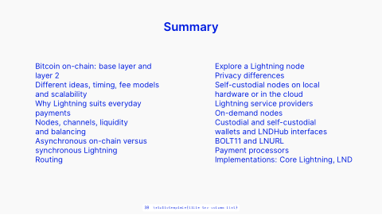

<!-- Generated by scripts/review.py sync. Edit template metadata or review.json. -->

# Title Two Column List

Organize related explanations or talking points using the title two column list layout.

Model: `title-two-column-list` · Family: Lists · Status: **in review**.

[Getting started](../../USING-STUDIO.md) · [All slide guides](../GUIDES.md) · [Current LaTeX source](../../../templates/studio/title-two-column-list.tex)

[Open this slide individually](../index.html?template=title-two-column-list)



The preview shows the shipped defaults. The thin bottom label belongs to the review catalogue.

## Insert this slide

Place this command outside another `frame`:

```latex
\studiotemplate{title-two-column-list}
```

## Change the content

This example uses supported fields. Omitted fields keep their shipped defaults.

```latex
\studiotemplate[
  title={Summary}
]{title-two-column-list}
```

## Complete one-slide example

Create `my-slide.tex` in the project root and paste:

```latex
\documentclass[aspectratio=169]{beamer}
\usetheme{bitpolito-studio}
\usepackage{bitpolitostudiotemplates}
\usepackage[backend=biber]{biblatex}
\addbibresource{bibliography.bib}
\begin{document}
\studiotemplate[
  title={Summary}
]{title-two-column-list}
\end{document}
```

```sh
python3 scripts/build.py my-slide.tex
# Installed TeX alternative:
python3 scripts/build.py my-slide.tex --backend native
```

Output: `build/my-slide.pdf`. On Windows use `py -3` instead of `python3`.

## Editable fields

Positions and available space refer to the original, fixed composition.
In the individual web view, select a field or enable **Show editable areas** to locate it.

| Field | What it changes | Position | Available space | Shipped value |
| --- | --- | --- | --- | --- |
| <code>title</code> | Main text (text) | upper centre | 17.2% wide × 7.6% high | <code>Summary</code> |
| <code>text-2</code> | Editable text (text) | middle left | 37.9% wide × 53.1% high | <code>Bitcoin on-chain: base layer and\\layer 2\par Different ideas, timing, fee models\\and scalability\par Why Lightning ...</code> |
| <code>text-3</code> | Editable text (text) | middle right | 37.0% wide × 53.1% high | <code>Explore a Lightning node\par Privacy differences\par Self-custodial nodes on local\\hardware or in the cloud\par Ligh...</code> |

Truncated values are shown in full at the start of the current source file.
A text field accepts LaTeX; a graphic field accepts an icon, `\includegraphics`, TikZ or math.

## Keep the composition

- Keep replacements within their allocated boxes. Shorten text or use explicit `\\` line breaks.
- Use `field={}` to hide content while retaining its space.
- Fonts, anchors and geometry remain fixed; unknown fields and overflowing content produce diagnostics.
- Text colour does not recolour supplied graphics; prepare another asset when its fixed colours must change.
- Some diagrams, QR codes and decorations are native source elements rather than configurable fields.
- For structural changes, edit [the current source](../../../templates/studio/title-two-column-list.tex). Catalogues and the showcase reuse it.

## Review

Reference: figma-0183.

Review margins, text, crops, shadows and optical balance using this stable model ID.
Record feedback in [the review ledger](../../../templates/review.json). Compilation is not graphical approval.
